# H2RES user guide: 12 November 2026

**Model inspected:** `D:\POSAO\H2RES_12.11.2026`. **Scope:** running and configuring the optimization model through its Python scripts and native data folder. The desktop GUI is excluded. For mathematical details, use the [model manual](H2RES_MODEL_MANUAL.md); for exact file and sheet names, use the [data reference](DATA_REFERENCE.md).

For complete configuration instructions, continue to the [main configuration guide](MAIN_CONFIGURATION_GUIDE.md). It covers all module and time-mode groups, table-level activation, dependencies, recipe variations and interpretation. The [complete option reference](MODEL_OPTION_REFERENCE.md) explains every recorded setting; the [equation chapter](MATHEMATICAL_FORMULATION.md) provides numbered physical/economic relationships and their source locations.

Screenshots below are browser captures of explicitly labelled, read-only documentation views of the actual local source, directory listings and worksheet cells. They are not screenshots of an IDE or Excel, and they do not depict optimization results. Worksheet previews show stored formulas without recalculating them. Full filenames, source hashes and screenshot hashes are recorded in the [capture manifest](screenshots/model_2026_11_12/capture_manifest.json). Nothing was changed in the model to make these images.

## 1. Where to start

Open the complete `H2RES_12.11.2026` folder in your editor. The entry point is `main.py`; it loads the policy files, selects inputs, reads data, constructs optimization problems and exports results. Running it starts optimization. Do not run a `Build_model*.py` or cost/solver script independently: these expect variables created by earlier stages in the shared execution namespace.

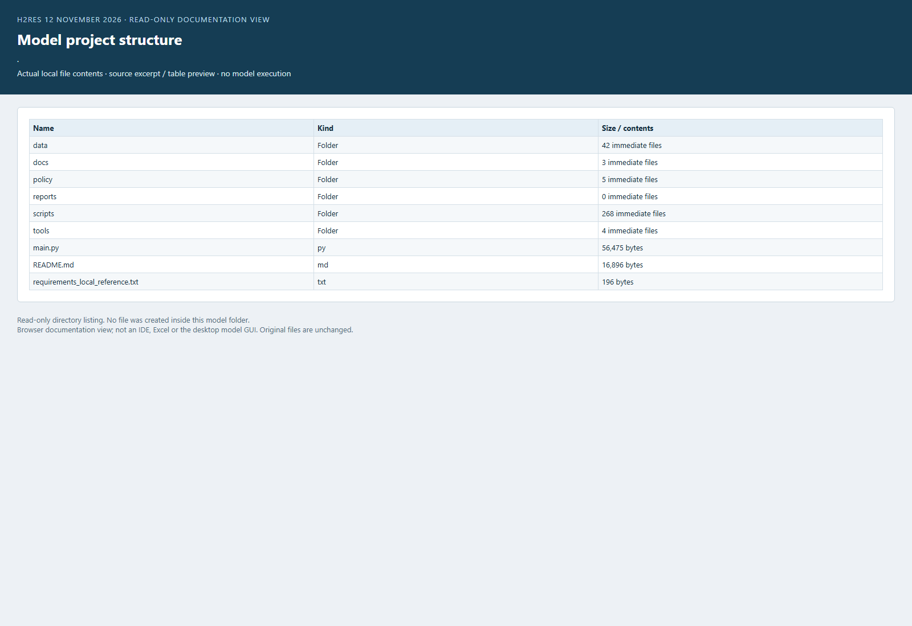

The folders most frequently used are:

| Location | What to open it for |
|---|---|
| `main.py` | Scenario name, feature switches, time mode, input selection, execution |
| `policy/` | Transition, economic, transport and numerical assumptions |
| `data/` | Native CSV and Excel inputs for the selected configuration |
| `scripts/` | Readers, variables, constraints, objective, solver and exporters |
| `docs/` | Supplied module descriptions; this guide complements those notes |
| `reports/` | Existing diagnostics and integration evidence; inspect their stated scope |
| `results/<scenario>/` | Results created when the selected run executes; location depends on mode |

Root-level `diagnose_*`, rebuild and acceptance scripts are maintenance tools. Their presence does not make them the normal launch command. The supplied `RUN_INSTRUCTIONS.txt` includes historical rebuild-harness instructions; use `main.py` for the workflow described here.

## 2. Install and launch the model environment

The model environment is separate from the data-preparation application's environment. The local reference specifies NumPy 2.4.4, pandas 3.0.2, openpyxl 3.1.5, matplotlib 3.10.8, Plotly 6.3.0 and gurobipy 12.0.3. It is a local version reference, not a complete cross-platform environment lock. Gurobi also needs a suitable license for the problem size.

Example PowerShell commands, entered in the model folder:

```powershell
Set-Location 'D:\POSAO\H2RES_12.11.2026'
py -3.12 -m venv .venv
& '.\.venv\Scripts\python.exe' -m pip install -r requirements_local_reference.txt
& '.\.venv\Scripts\python.exe' -c "import numpy, pandas, openpyxl, matplotlib, plotly, gurobipy; print('Imports OK')"
```

Review the scenario and inputs described below before the final launch:

```powershell
& '.\.venv\Scripts\python.exe' -u main.py
```

If a configured model environment already exists, select that interpreter rather than creating another one. In an editor, run `main.py` with that same interpreter. The script resolves its working directory to its own model folder, including when an editor starts it from elsewhere. Do not import `main.py` as a quick package test: its top-level execution can start a solve.

## 3. Edit the scenario and main switches

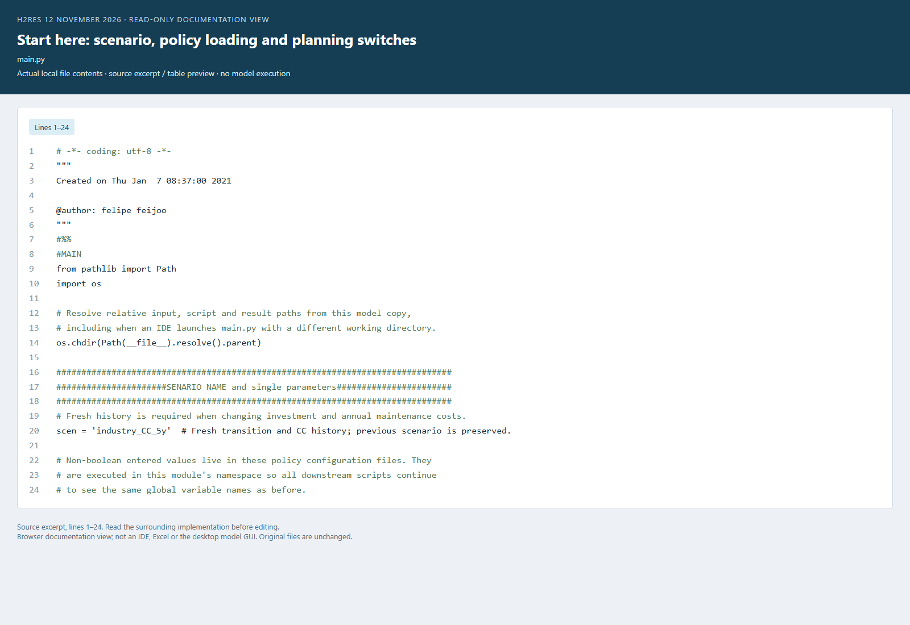

Set `scen` to a new name for a materially different study, for example `HR_categories_baseline_2026_11_12`. The supplied name is `industry_CC_5y`. A name is a results/history identifier; its text does not configure the actual year grid or policy. Those come from switches and input tables.

The delivered selection is:

| Control | Inspected value | Consequence |
|---|---|---|
| `Myopic` | `True` | Sequential planning with historical handoff |
| `partial_perfect_foresight` | `False` | Partial-foresight sampling is not selected |
| `model_heating` | `True` | Heating blocks are enabled |
| `model_transport_and_industry` | `True` | Legacy transport/industry blocks are enabled |
| `model_industry_categories` | `True` | Industry is represented by categories |
| `model_complex_industry` | `False` | Complex process replacement is not selected |
| `industry_category_electricity_case` | `conservative` | Main category technology workbook is used |
| `model_efuel` | `True` | E-fuel technology and policy families are selected |
| `model_simple_industry` | `False` | Separate product-industry workbook is not read |
| `DSM_day`, `DSM_week` | Both `False` | Basic electricity load is not shifted by DSM |
| `disable_transport_infrastructure` | `False` | This debug switch does not suppress infrastructure |
| `myopic_resume_from_results` | `True` | Compatible completed history may be reused |

Exact capitalization matters. The configuration inventory records all inspected assignments in [model_configuration.csv](inventory/model_configuration.csv). This table is a snapshot, not a recommendation to leave every setting unchanged.

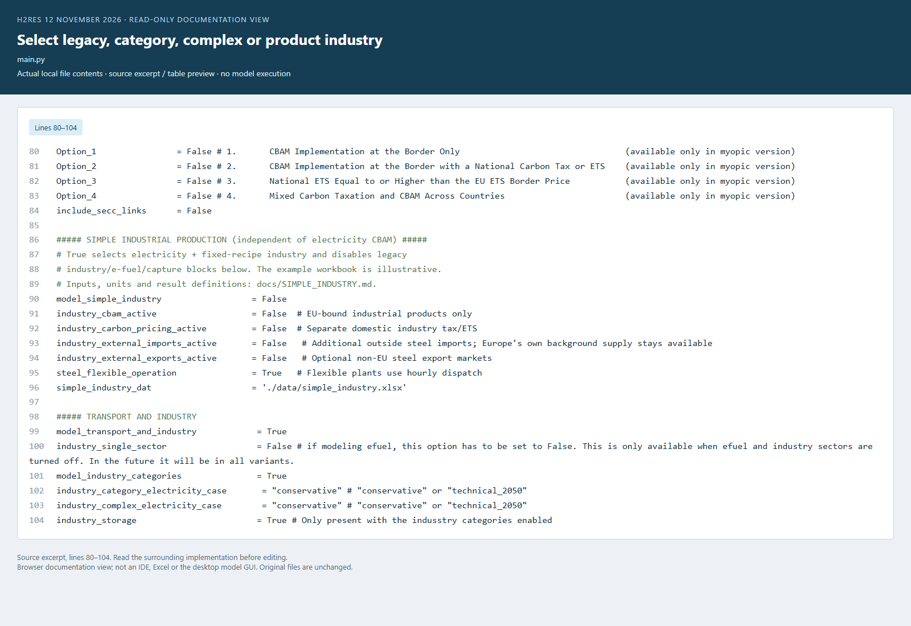

Regular, category and complex industry require a coherent selection. Categories and complex industry are mutually exclusive. Category thermal storage requires categories. Simple product industry configures a different run and disables overlapping legacy blocks. Standalone H2 transmission and terminals are disabled in the delivered e-fuel selection; do not infer activity just because the relevant file is present.

## 4. Policy files you will frequently edit

`main.py` executes the policy modules before deriving most run selections. Use these files for their corresponding settings; a workbook does not replace a Python policy switch.

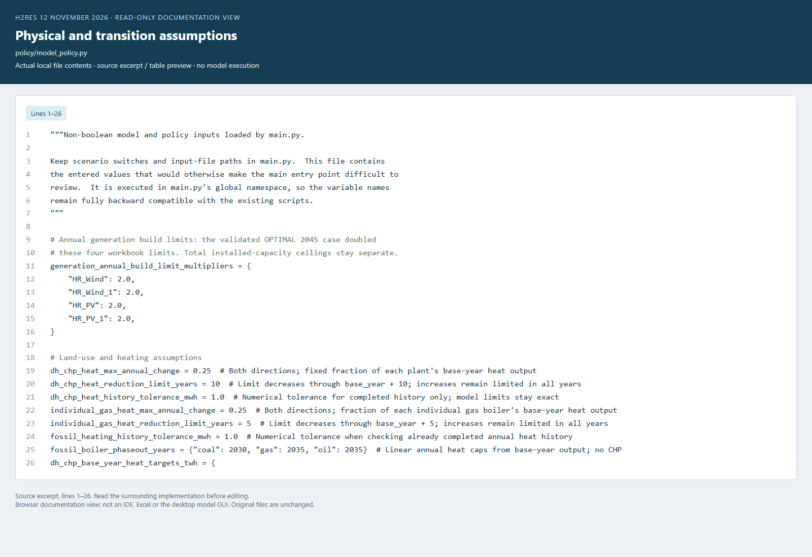

`policy/model_policy.py` contains physical/economic and transition assumptions. In this snapshot these include the industry's 2045 fossil-combustion transition completion year, heating turnover restrictions, annual investment multipliers, discounting and active systems for the product-industry example. The discount rate, discount base year and capital finance rate must remain consistent with the way costs are reported. Fossil combustion retirement is not a claim of zero industrial process emissions.

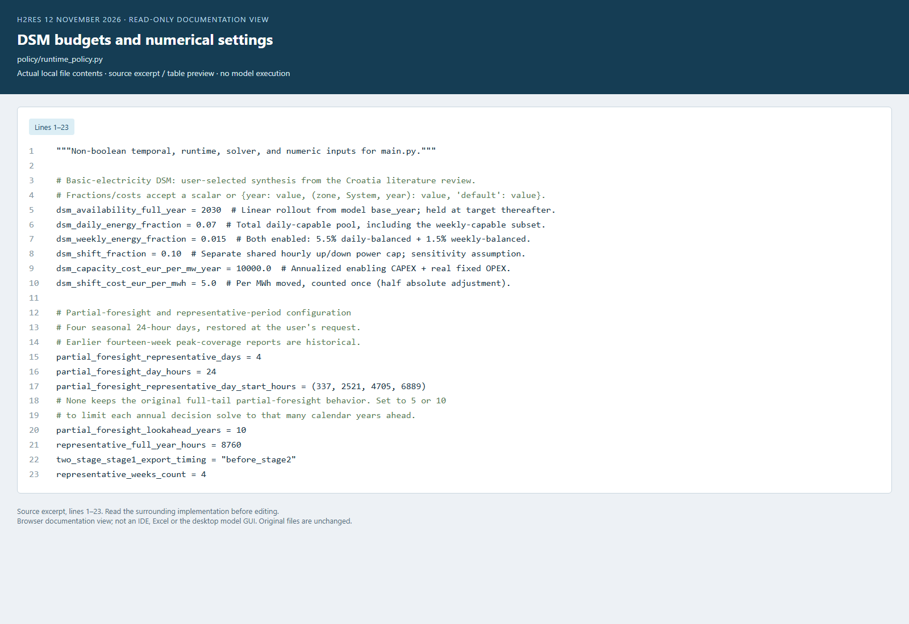

`policy/runtime_policy.py` contains solver methods, tolerances, numerical scaling, time limits, recovery settings and DSM parameters. In this snapshot stage-1 primary Method is 2, rolling Method is 1, and several time limits are zero, meaning unlimited in the applicable wrappers. A long solve is therefore not necessarily stuck. Changing tolerances can change acceptance; record numerical settings with the result.

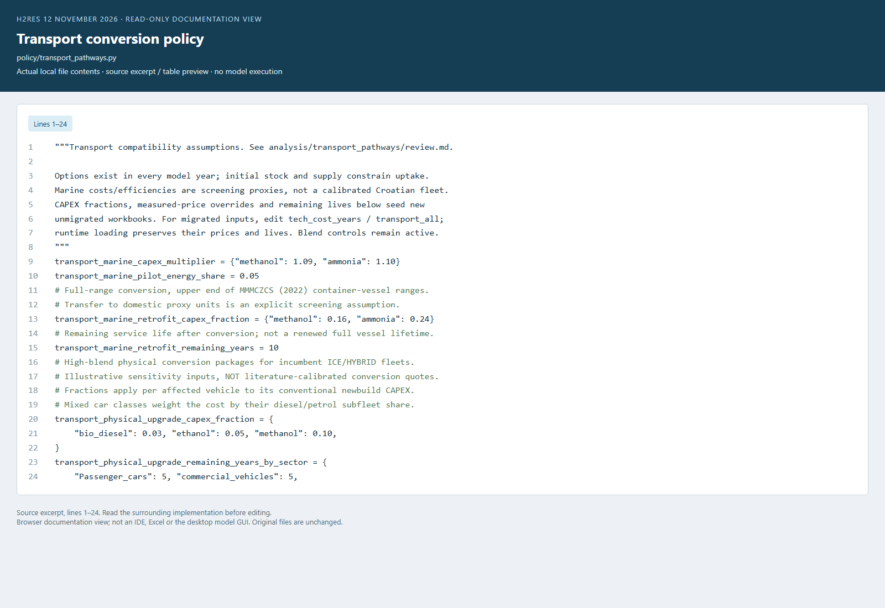

`policy/transport_pathways.py` contains transport conversion and compatibility assumptions. Keep these consistent with `transport_all`, `transport_ICE_prim` where used, the annual transport targets and the hourly service profiles.

## 5. The data folder and exact workbook selection

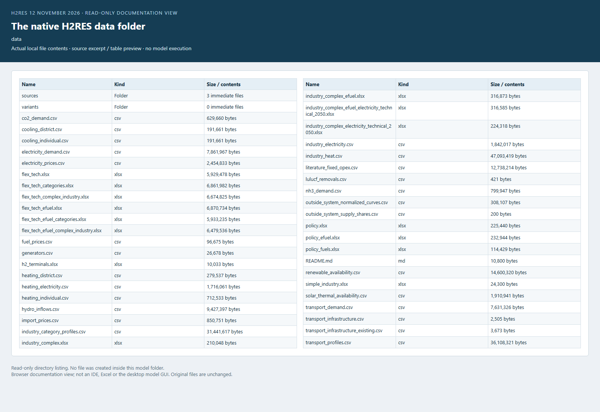

Keep CSVs and workbooks together under `data/`, including the nested `variants/technical_2050/` folder. The model reads specific relative paths. Renaming a workbook to look more convenient does not change the file-selection code. The inspected input inventory contains 46 files, including nested source records and variants; workbook inventories cover 774 worksheets across the supplied workbooks.

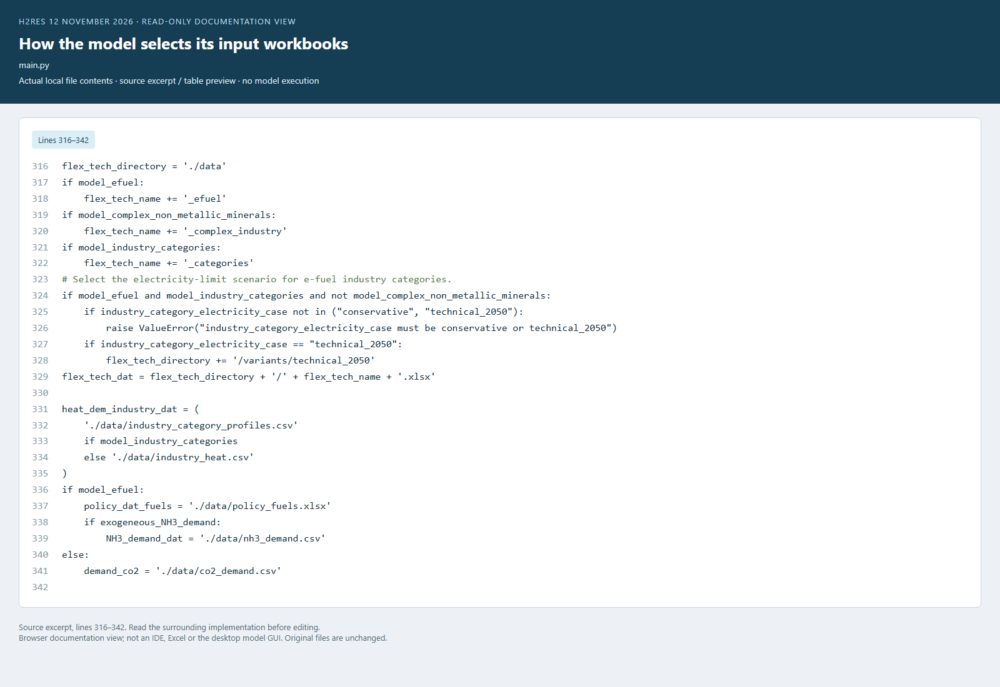

The normal technology selection is:

| Industry representation | `model_efuel=False` | `model_efuel=True` |
|---|---|---|
| Regular: categories and complex both false | `flex_tech.xlsx` | `flex_tech_efuel.xlsx` |
| Categories | `flex_tech_categories.xlsx` | `flex_tech_efuel_categories.xlsx` |
| Complex | `flex_tech_complex_industry.xlsx` | `flex_tech_efuel_complex_industry.xlsx` |

For e-fuel categories with `industry_category_electricity_case='technical_2050'`, the technology path is `data/variants/technical_2050/flex_tech_efuel_categories.xlsx`. The main conservative path has the same basename directly under `data/`. Complex electricity assumptions select `industry_complex*_electricity_technical_2050.xlsx`; they do not rename the associated flex-tech workbook.

`model_efuel=True` selects `policy_efuel.xlsx`, otherwise `policy.xlsx`. E-fuel carrier price assumptions additionally use `policy_fuels.xlsx`. Category demand timing uses `industry_category_profiles.csv`; ordinary industry timing uses `industry_heat.csv`. Follow the selected filenames printed by the reader.

## 6. Generators and their related tables

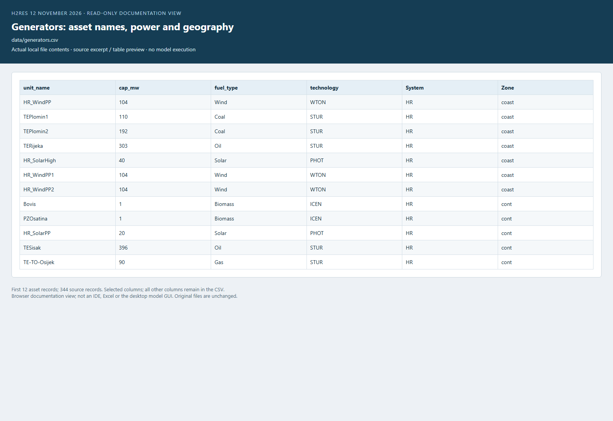

`data/generators.csv` is the native generator inventory. Each asset has an exact `unit_name`, installed `cap_mw`, fuel/technology and `System`/`Zone`. Other native fields describe efficiency, costs, ramping, CHP heat coupling, lifetime/retirement and hydro storage characteristics. MW power and GWh storage energy are different quantities.

A generator must be represented consistently wherever its identifier is used. When adding or renaming a unit, review the following relationships:

| Related input | What must agree |
|---|---|
| `active_zones` | The asset's zone and System belong to the intended model geography |
| `renewable_availability.csv` | Required VRE/run-of-river curve columns use exact generator IDs |
| `hydro_inflows.csv` | Relevant reservoir/pumped-hydro columns use the required exact IDs |
| `cap_inv_lim` | Applicable unit, geography and annual investment coverage are present |
| `tech_cost_years` | Applicable generator/technology capital-cost trajectory is unambiguous |
| `fixedOPEX_cost_years` | Applicable fixed-cost trajectory and units agree |
| Policy calibration tables | Generation and hydro targets match actual modeled assets and fuels |

These are table-specific relationships: not every workbook is stored as a simple `(year,unit_name,zone,System)` table. Some native sheets contain multiple stacked/wide blocks. Follow the input reader and preserve its keys rather than adding a superficially similar column. A zone with no existing generator can still have demand and receive electricity through modeled links; do not invent a power plant merely to populate every zone.

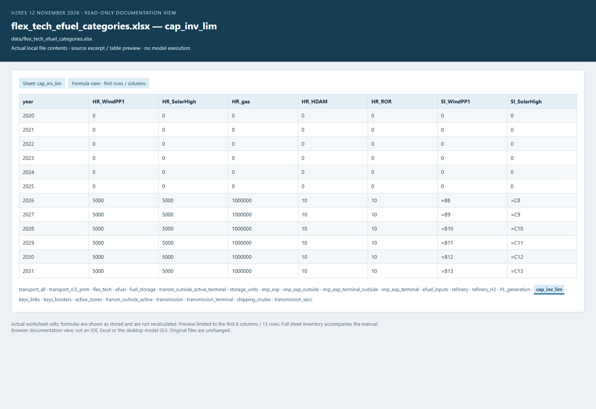

`cap_inv_lim` controls additions in the units expected for each asset family. Zero prevents additions for the applicable entry; it does not remove existing capacity. Sparse decision years require correct aggregation of underlying annual limits. A blank is not universally equivalent to zero: the reader's scalar fallback and unrestricted-limit conventions matter.

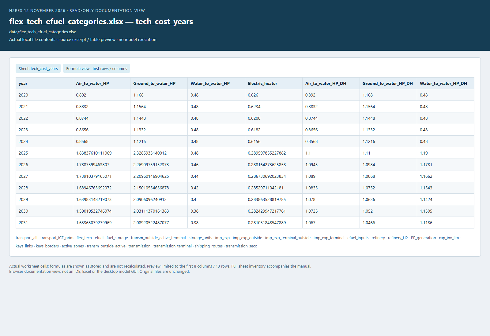

`tech_cost_years` supplies cost trajectories. Confirm the physical unit and price basis before transferring a row between generation, energy storage, heating, vehicles or capture. A unit may not have two conflicting applicable trajectories. Check costs and investment limits together whenever the GENCO inventory changes.

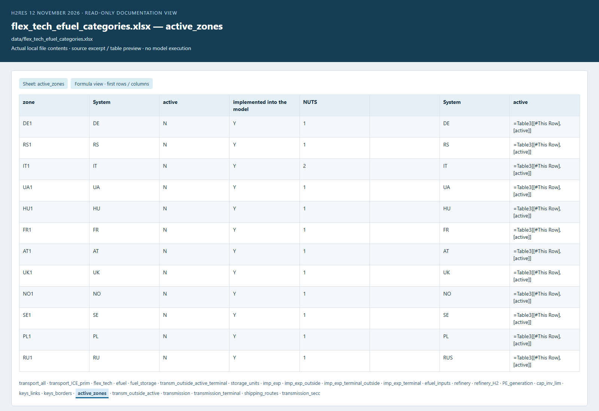

`active_zones` contains retained countries and zones as well as selection columns. A country appearing in this worksheet is not automatically active. Inspect `active` and the reader's scoping rules, then ensure matching demand, transmission, heating, industry and transport inputs. The preview starts at the first stored rows; inactive rows in a screenshot do not imply the model has no active zones.

## 7. Flex-tech variations: what changes and what to review

### 7.1 Regular industry without e-fuels

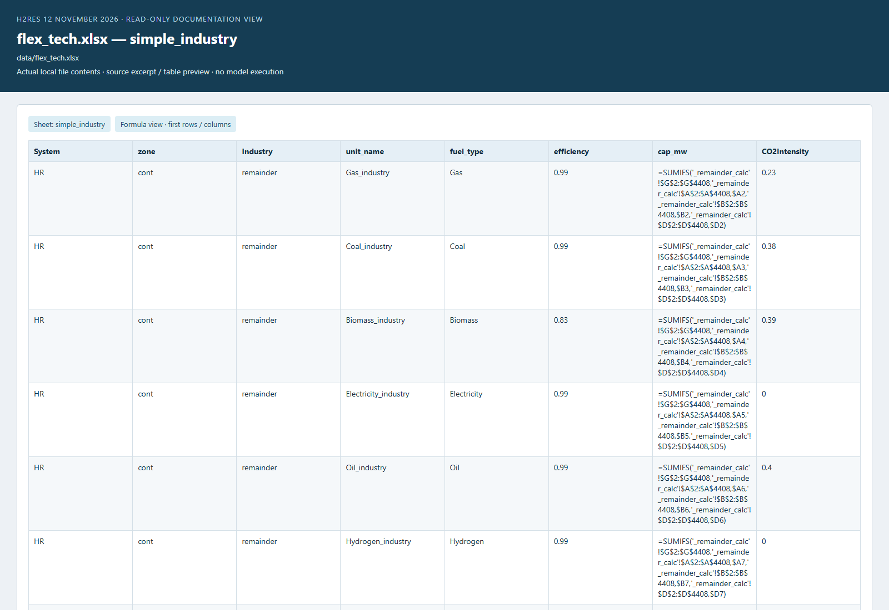

`flex_tech.xlsx` provides the regular technology layout. The `simple_industry` worksheet is the pooled legacy service representation. It must reconcile with detailed-sector inclusion in `Industry_data`: an excluded detailed service belongs in the pool, while a retained detailed service must not be counted again. Preserve demand and capacity units while recomputing the remainder. A formula visible in a cell does not establish that its cached numeric value is current.

### 7.2 Category industry without e-fuels

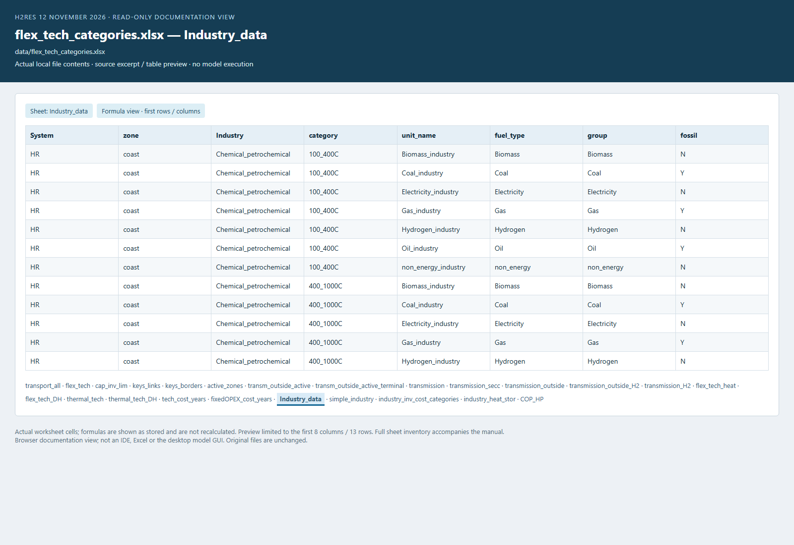

`flex_tech_categories.xlsx` distinguishes industry and service/temperature category. Review `Industry_data`, `industry_inv_cost_categories`, applicable heat-pump limits and category thermal storage. The `simple_industry` remainder can legitimately be empty when all applicable services are detailed. Do not populate it merely because an empty sheet looks suspicious.

### 7.3 Complex industry without e-fuels

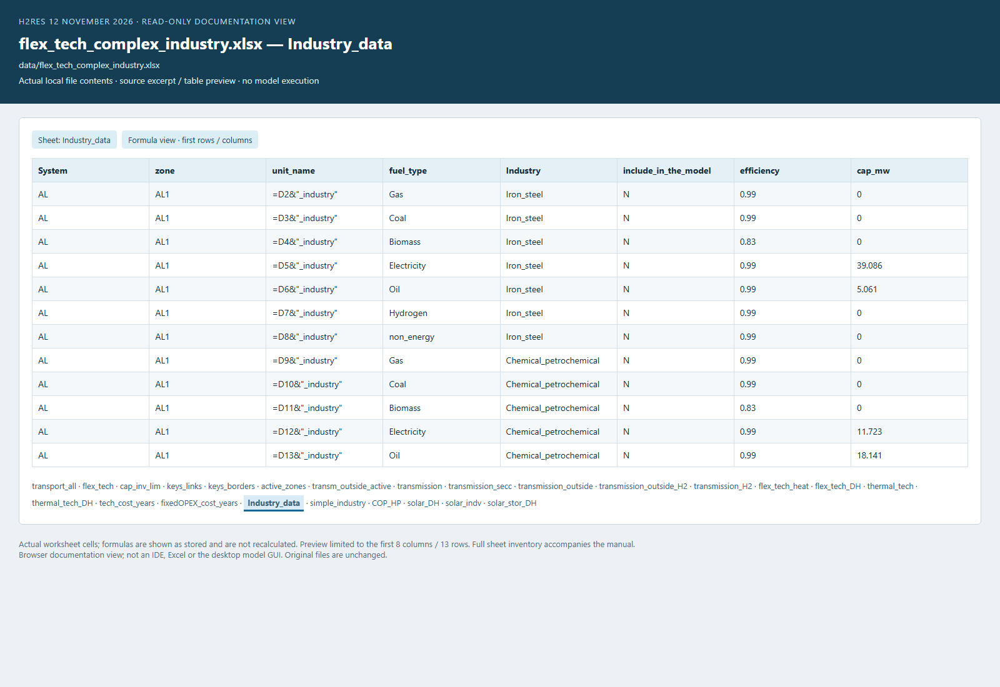

`flex_tech_complex_industry.xlsx` supplies the common technologies while `industry_complex.xlsx` supplies the process representation. Selected complex sectors replace their overlapping legacy services. Changing the process workbook alone does not activate all its sectors: `complex_industry_sectors` also scopes the model; its delivered policy default is `Non_metallic_minerals`.

### 7.4 Regular industry with e-fuels

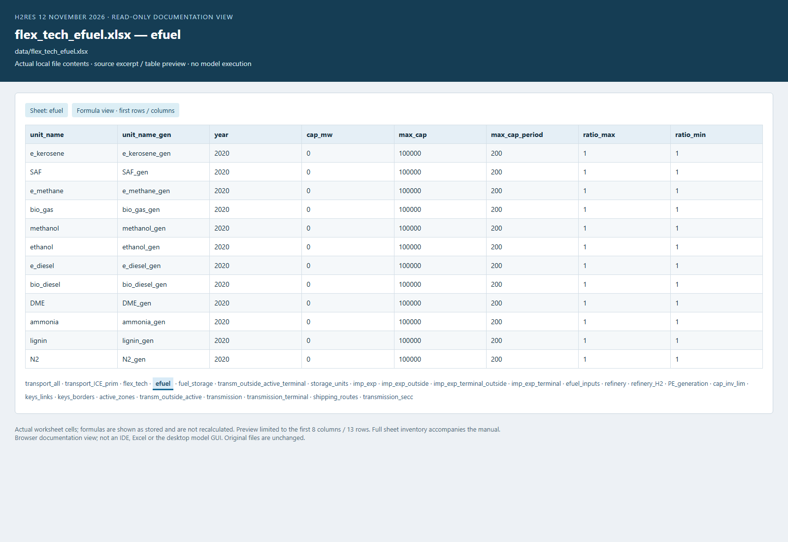

`flex_tech_efuel.xlsx` adds the e-fuel conversion, feedstock, storage, trade and applicable refinery/terminal layout. Review `efuel`, `efuel_inputs`, `fuel_storage`, `storage_units`, import/export sheets and transmission/routes together. A conversion output creates corresponding input and auxiliary demand; it is not free energy.

### 7.5 Category industry with e-fuels

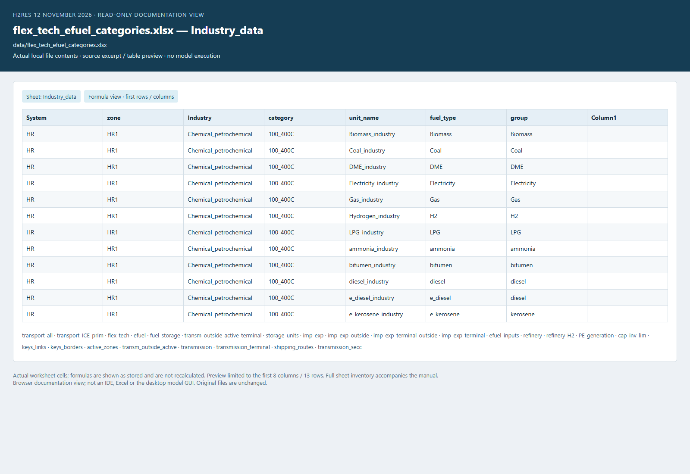

`flex_tech_efuel_categories.xlsx` is the delivered conservative selection. In addition to service data, examine category costs, `industry_heat_stor`, industrial capture and process-emission sheets, compatibility rules and replacement ceilings. The `simple_industry` worksheet remains a pooled remainder, not the separate product model.

### 7.6 Complex industry with e-fuels

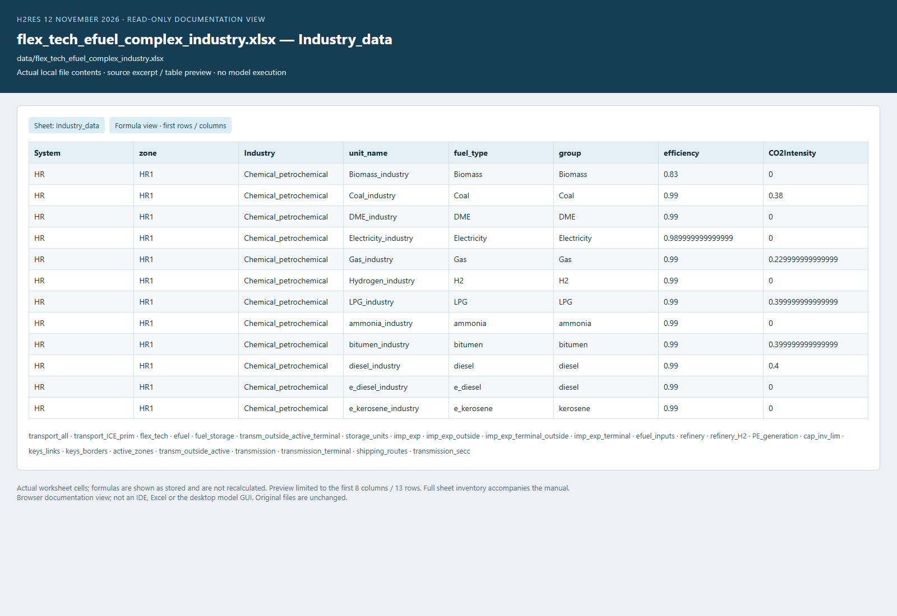

`flex_tech_efuel_complex_industry.xlsx` is paired with `industry_complex_efuel.xlsx`. Keep process heat/electricity, non-energy feedstocks, carrier conversion and process carbon consistent. Separate process and other-carbon balances are enabled in the current `main.py`; untagged imported CO2 cannot be assumed eligible for geological storage.

### 7.7 Technical-2050 category case

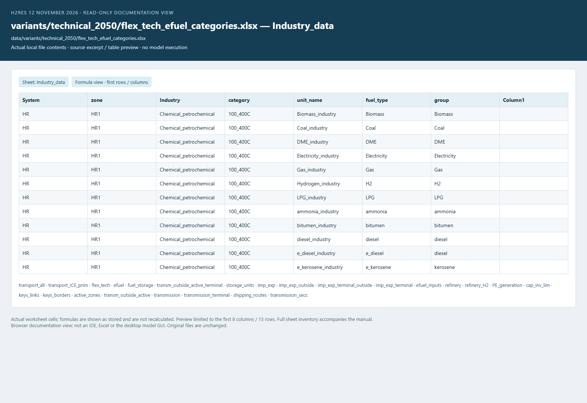

`variants/technical_2050/flex_tech_efuel_categories.xlsx` changes the relevant industrial electricity assumptions. Select it through `industry_category_electricity_case`; do not overwrite the conservative workbook. This is a technical scenario variant, not a forecast or an automatic renewable-energy target.

### 7.8 Process input workbook

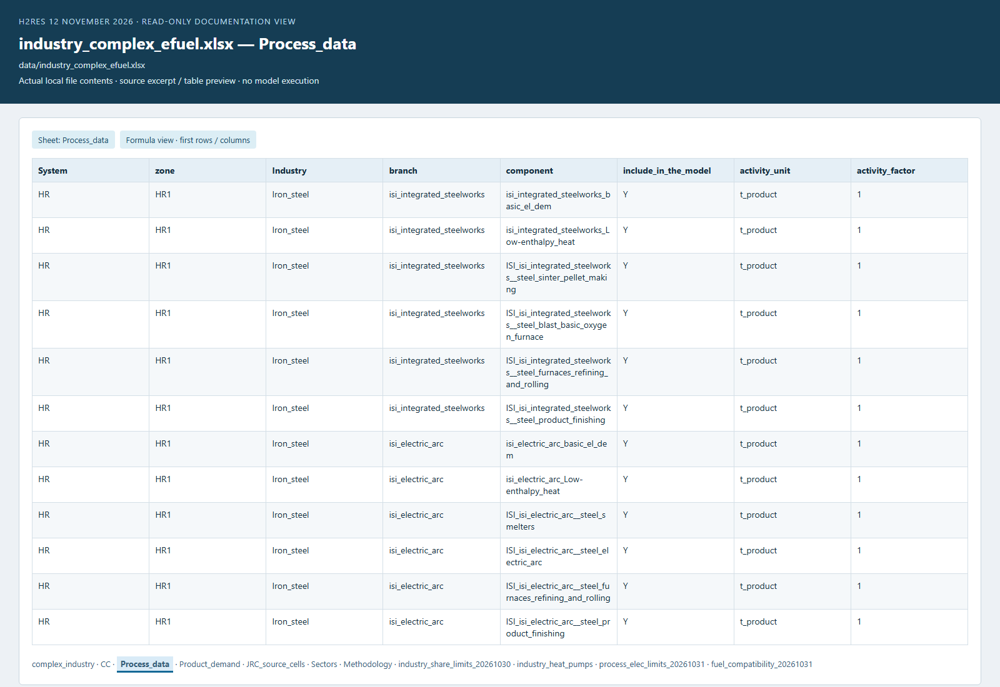

The complex-industry companion workbooks contain `Process_data`, `Product_demand`, `complex_industry`, `CC` and methodology/compatibility sheets. Check product and component identifiers, activity units, useful service, final inputs, capture eligibility and the retained legacy remainder. The technical-electricity case must use the matching process workbook for its e-fuel selection.

## 8. Policy workbooks, years and demand trajectories

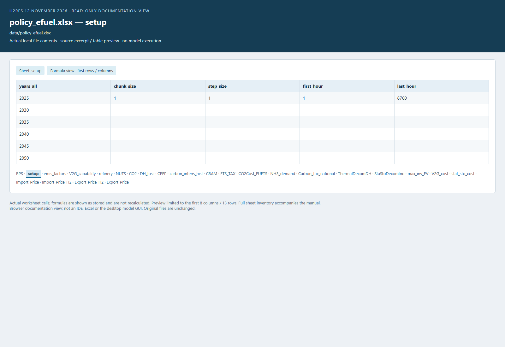

The inspected `policy_efuel.xlsx` `setup` sheet has decision years 2025, 2030, 2035, 2040, 2045 and 2050. Its first row of values sets `chunk_size=1`, `step_size=1`, `first_hour=1` and `last_hour=8760`. A five-year spacing between decisions is different from `chunk_size`. Follow the reader's construction of each planning window; the scenario-name suffix is not a year-grid control.

When changing the horizon, also extend applicable annual costs, limits, demand changes, carbon/RPS trajectories, transport paths, supplier/market inputs and retirement assumptions. Changing only `setup` can create missing-year data or an inconsistent scenario. The weather/source year of an hourly shape is not the same as a future decision year.

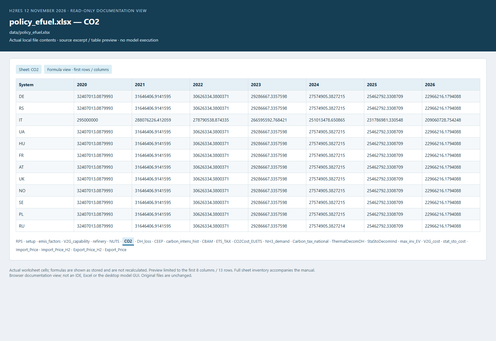

The `CO2` sheet supplies the carbon-limit trajectories selected by the model. Read the implemented units and System mapping. Carbon limits, ETS/carbon prices, capture, LULUCF removals and CBAM switches have different roles. The current configuration enables the carbon limit and disables LULUCF removals.

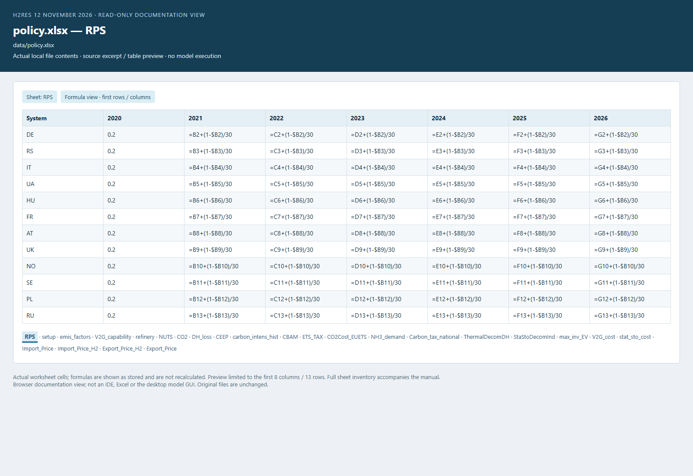

`RPS` controls the implemented renewable-electricity share policy. It does not by itself impose 100% renewable final energy across heating, industry and transport. The preparation tool's whole-energy preset is an additional adapter policy with its own coverage and compatibility limits; it is not implied by setting RPS to one.

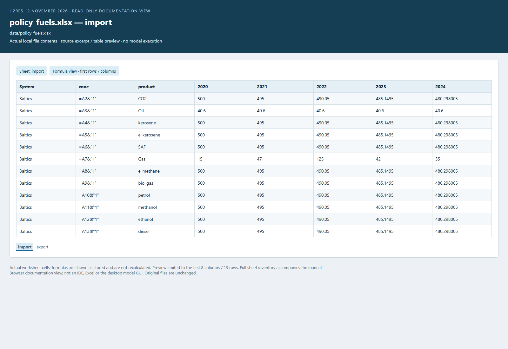

`policy_fuels.xlsx` supplies applicable e-fuel carrier price assumptions. Keep these distinct from primary fuel prices in `fuel_prices.csv` and electricity import prices. Do not count the same feedstock purchase again at every conversion stage.

Other frequently reviewed policy sheets include `dem_change`, `Industry_dem_change`, `Heat_dem_change`, `Heat_dem_change_DH`, `transport_targets`, `transport_targets_efuel`, `biomass_caps`, `generation_targets`, `hydro_caps`, `outside_trade`, `CO2Cost_EUETS`, `Carbon_tax_national`, `CBAM` and `ETS_TAX`. Presence is not activation: both the selected workbook and Python flags determine whether a policy applies.

## 9. Hourly electricity, heat and transport inputs

`electricity_demand.csv` is the basic electricity-demand profile by period, System and Zone. `industry_electricity.csv` and `heating_electricity.csv` participate in the model's sector-accounting boundary; follow the reader so that electricity already embedded in basic load is not charged twice. `renewable_availability.csv` and `hydro_inflows.csv` use their exact asset columns and expected normalization. Check full hourly coverage and period ordering.

Heating uses `heating_individual.csv`, `heating_district.csv`, relevant electric-heating data, the flex/thermal heating sheets, COP data and solar availability where enabled. The delivered solar individual/DH and cooling switches are off. Changing a switch does not create missing profiles or costs.

Transport uses `transport_profiles.csv`, `transport_demand.csv`, fleet/technology sheets, compatible fuels, policy paths and infrastructure CSVs. Service, final energy and vehicles are different units. V2G availability is not the same as driving demand. Navigation modes also need coherent inland/coastal allocation in a regional dataset.

## 10. New electricity demand shifting

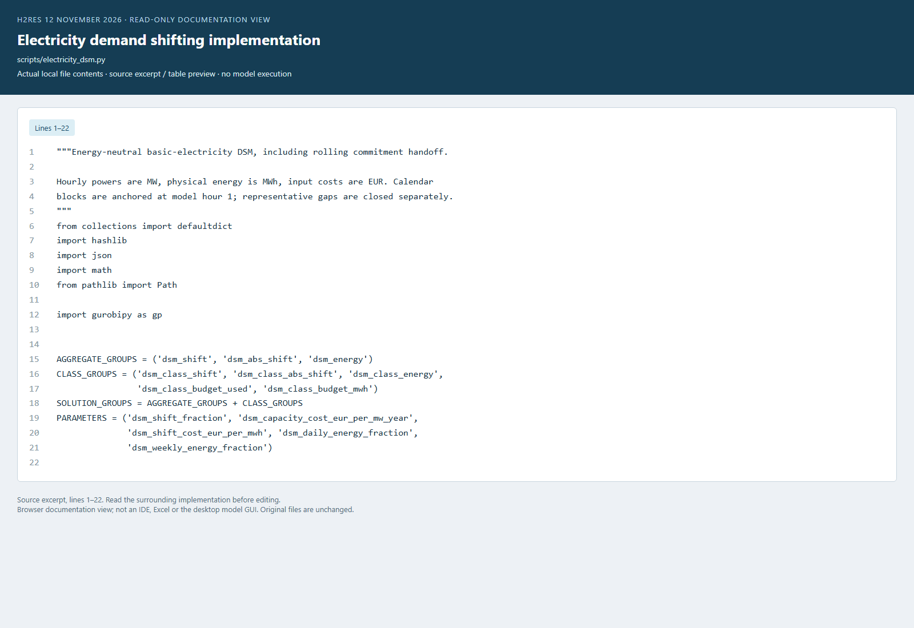

For a DSM study, choose a fresh `scen` and enable the applicable controls in `main.py`:

```python
DSM_day = True
DSM_week = True
dsm_energy_budget_active = True
dsm_availability_ramp_active = True
```

Review the parameters at the beginning of `policy/runtime_policy.py`. The supplied energy pools are 7% daily-capable including a 1.5% weekly subset; both together mean 5.5% daily-balanced and 1.5% weekly-balanced. Rollout reaches its target in 2030. The shared hourly adjustment cap is 10% of baseline load, capacity cost is EUR 10,000/MW/year and activation cost EUR 5/MWh moved. These are scenario assumptions.

DSM shifts basic electricity load while conserving energy within its daily/weekly blocks; it does not automatically shift every sector's separate modeled demand. Its hourly power and moved-energy limits are separate. For example, the symmetric 10% hourly cap can bind before the full 7% energy allowance is usable. Read [model manual section 19](H2RES_MODEL_MANUAL.md#19-basic-electricity-demand-side-management-in-this-version) and the supplied [DSM notes](model_notes_2026_11_12/ELECTRICITY_DSM.md) before changing sampled/rolling behavior.

Demand-response background is provided by [R35](REFERENCES.md#r35), [R36](REFERENCES.md#r36) and [R37](REFERENCES.md#r37); these sources do not validate the local energy-pool percentages or costs.

## 11. New product-industry workbook

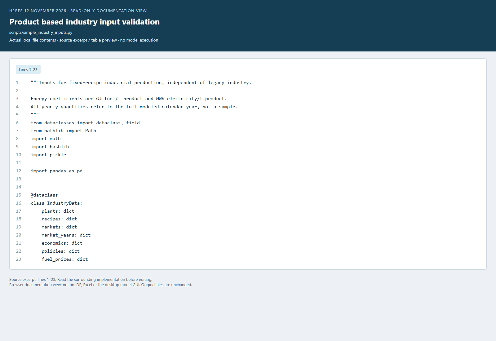

`data/simple_industry.xlsx` is a separate product model, selected by `model_simple_industry=True`. It is **not** the `simple_industry` worksheet in flex-tech. Enabling it configures a different run: the legacy industry/transport, e-fuel and overlapping capture/H2 blocks are disabled. Heating keeps its own selection.

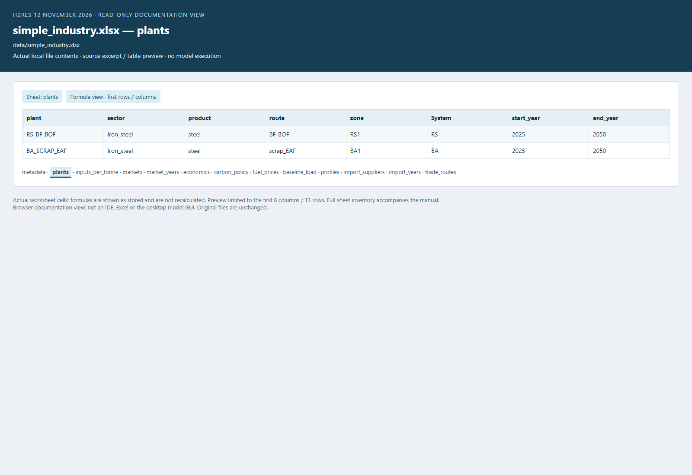

Review `plants` for product, route, geography, t/h capacity, net MWh/t electricity, connection power, operating years, flexibility and capital inputs. Review `inputs_per_tonne` for fixed GJ/t recipes and emissions. The example RS BF-BOF and BA EAF cases are illustrative plants, not calibrated Smederevo or Zenica facilities.

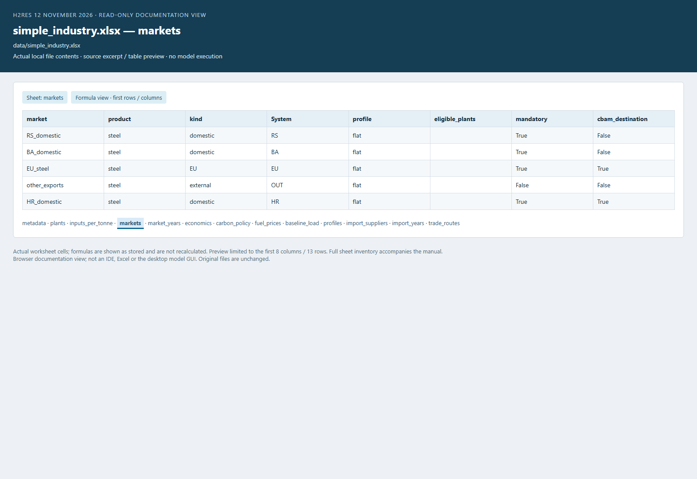

`markets` defines destinations and eligibility; `market_years` supplies annual tonnes, sale prices and hourly delivery ceilings. Mandatory domestic/Europe markets must be served. Product output is a decision bounded by capacity; a plant can be displaced by other modeled or eligible outside suppliers. Demand is not automatically reduced when supply is inadequate.

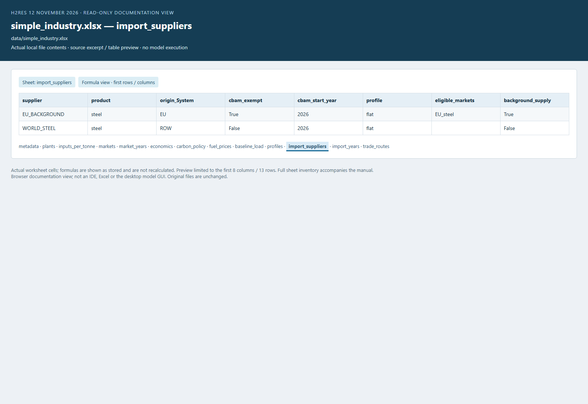

`import_suppliers` and `import_years` provide origin, eligibility, bounded availability, cost and embedded emissions. `trade_routes` may further restrict or price supplier/market pairs. An outside supplier has one annual budget shared across its destinations. The EU background offer is restricted to the rest-of-Europe market; it is not unrestricted domestic backup.

Industrial CBAM, domestic carbon pricing and outside import/export controls are separate `main.py` switches. Electricity CBAM Options 1–4 are separate again and mutually exclusive. Baseline load removal must be calibrated if a plant's electricity is already included in the basic demand CSV. Zero removal in the example means its plant electricity is added. See [model manual section 20](H2RES_MODEL_MANUAL.md#20-product-based-simple-industry-and-regional-trade) and the supplied [product-industry notes](model_notes_2026_11_12/SIMPLE_INDUSTRY.md).

## 12. Source files used during execution

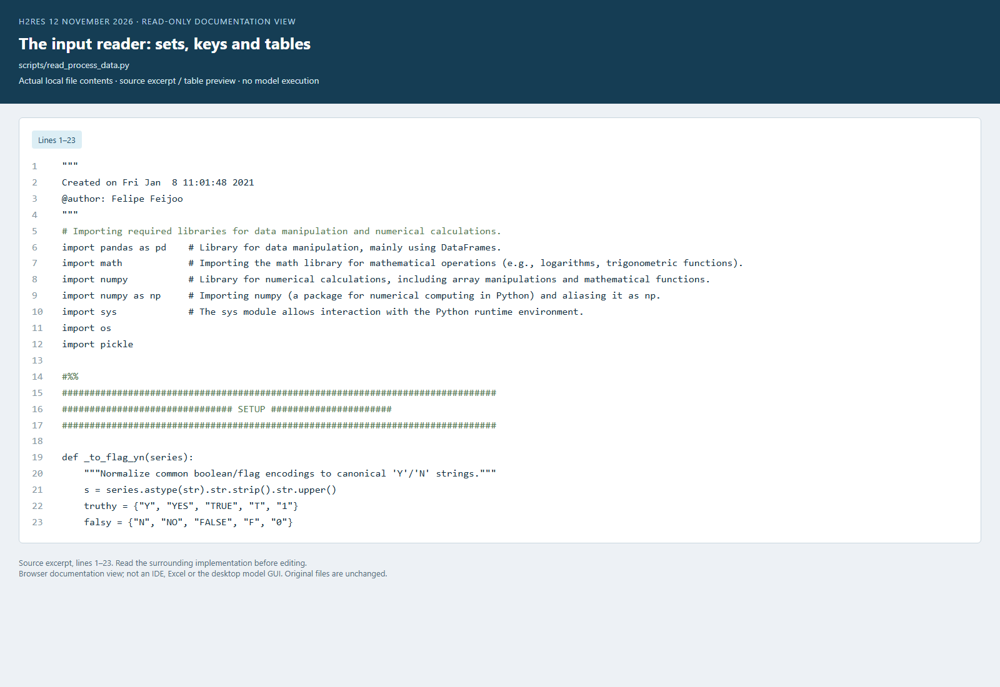

`scripts/read_process_data.py` reads native files, scopes active systems/zones, interprets table layouts and creates sets and numerical dictionaries. Open this file when checking what a workbook column means or which sheet is read under a flag. An error naming a sheet or annual trajectory usually needs inspection of the selected workbook and reader, not an edit to the solver.

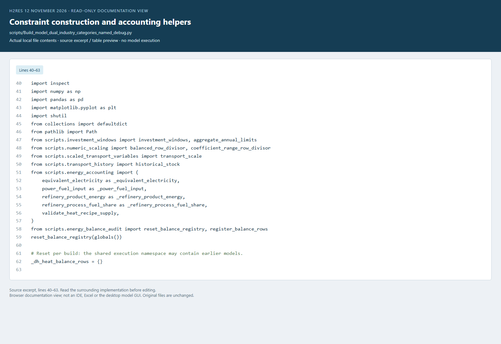

`scripts/reading_prev_and_vars_def_dual_industry_categories1.py` declares variables and loads historical decisions. `scripts/Build_model_dual_industry_categories_named_debug.py` constructs physical and policy constraints. Helper modules implement shared accounting, industry transition, carbon, DSM and product industry. Read the relevant helper as well as the calling equation.

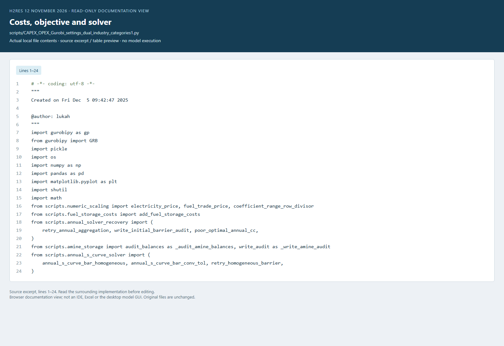

`scripts/CAPEX_OPEX_Gurobi_settings_dual_industry_categories1.py` constructs cost terms, the objective and solver/recovery behavior. Export and plotting scripts run after the applicable solve path. For line-level locations use the [code reference](CODE_REFERENCE.md); static call-site counts are not the size of a constructed optimization matrix.

## 13. Before and after a run

Before running, verify a fresh/coherent scenario name, the intended interpreter/license, active zones, actual selected workbooks, decision years and complete applicable cost/limit/profile coverage. Close Excel before modifying or replacing its workbooks. Review service remainders, sector electricity accounting and any historical baseline removals. Keep a copy of the selected code, inputs and policies with their hashes.

Run `main.py` with the selected environment. Read the selected input paths and first planning-year messages. Preserve the console log if input validation, model construction or optimization fails; these are different stages. The default resume option can skip compatible completed years, so use a new scenario name after changing geography, accounting, recipes, costs or policies.

After a run, inspect solver status, provisional/recovery notices, physical-balance audits, carbon/capture checks, accepted decision years and exported annual/hourly balances before interpreting plots. The delivered configuration allows provisional solutions and warning-only postoptimal checks. A completed CSV export is therefore not automatically a strict optimality/feasibility certificate.

For DSM inspect the hourly, class, summary and assumption exports. For product industry inspect production, demand satisfaction, imports, sales, inventories, supplier origin, territorial/embedded emissions and fiscal/CBAM accounts. Compare scenarios on the same energy, geographic, economic and time boundaries.

## 14. Common issues and the first files to inspect

| Symptom | First inspection |
|---|---|
| Missing module or Gurobi failure | Selected interpreter, model requirements and Gurobi license |
| Different workbook used than expected | `main.py` flags, electricity case and printed `tech_dat`/policy path |
| Missing or ambiguous investment/cost trajectory | Exact generator ID, relevant System/zone/year and all applicable blocks in `cap_inv_lim`/cost sheets |
| Old or missing industry remainder | Detailed inclusion in `Industry_data`, pooled `simple_industry`, formula cache/recalculation and units |
| `#REF!`, formula error or blank numeric input | Native workbook and cached value; preserve the original and recalculate a working copy using a spreadsheet application |
| Wrong country or zero regional demand | Active zones, System/Zone mapping, reader scoping and hourly coverage |
| New study unexpectedly resumes old years | `scen`, resume controls and existing history compatibility |
| Infeasible product demand | Mandatory tonnes, eligible plants/suppliers, annual/hourly capacity and import switches |
| DSM has no effect | Main switches, rollout year, energy budgets, hourly cap and whether the load is basic electricity |
| Long solve or recovery | Runtime time limits, selected mode, solver log, matrix size and numerical diagnostics |
| Run finishes with warnings | Provisional acceptance settings, actual solver status and physical-quality reports |

Do not bypass a missing trajectory with zero cost or delete an unsupplied demand merely to get past validation. Review identifiers, units and the intended scenario first. The documentation inventory and screenshots are evidence of inspected content, not proof that every retained workbook or run mode is feasible.

## 15. References, provenance and sharing

Use the [scientific and data references](REFERENCES.md), [BibTeX bibliography](references.bib), [assumption register](ASSUMPTIONS_AND_LIMITATIONS.md), [exact source/input inventory](inventory/documented_version.json) and [workbook schema](inventory/workbook_schema.csv). The 2004 H2RES island-model lineage and later planning/optimization papers provide background; later local DSM and product-trade extensions are identified separately in this edition.

This documentation was built from static inspection of the specified 12 November source/input snapshot. No optimization was run to prepare it. The separate data extractor still documents its own native/refactored export contracts; this manual does not certify its adapter against every new model extension. Share the PDF for reading, or the documentation ZIP for offline HTML navigation, source notes, screenshots and machine-readable inventories.
