This GitHub reading edition embeds the same 62 vector equations as the PDF and offline HTML. The [editable formulation source](MATHEMATICAL_FORMULATION.md) retains the LaTeX expressions.

# Mathematical formulation and equation-to-code guide

**Version:** the inspected `H2RES_12.11.2026` snapshot. This chapter explains the principal equation families across the available configurations. It complements the [configuration guide](MAIN_CONFIGURATION_GUIDE.md), [complete option reference](MODEL_OPTION_REFERENCE.md) and [line-level constraint inventory](inventory/model_constraint_calls.csv). No optimization was executed to prepare this chapter.

Equations marked **reindexed** retain the stated source relationship with shorter symbols. Equations marked **structural** combine or suppress asset-specific branches, bounds or terms to explain the mechanism; they must not be substituted for the executable rows. Derived identities explain accounting or interpretation rather than claim an additional solver constraint. Every displayed equation has a source anchor resolved to actual line positions in [equation_sources.json](inventory/equation_sources.json). The inventory includes all matching lines where a symbol occurs more than once.

## 1. Sets, symbols and physical units

| Symbol | Meaning |
|---|---|
| `s`, `z`, `l` | System, active zone and directed transfer route |
| `y`, `a` | Decision year and investment vintage |
| `t`, `T_y`, `B` | Modeled hour, year-specific modeled-hour set and daily/weekly block |
| `g`, `k`, `f` | Generator, conversion/storage technology and fuel/carrier |
| `i`, `b`, `p`, `m` | Industrial service/component, branch, product plant/supplier and product market |
| `X`, `K` | New and available capacity in the asset's declared native unit |
| `P`, `Q`, `U`, `F` | Electricity, useful heat/service, carrier input and transfer rates |
| `S`, `C`, `D` | Stored inventory, charging and withdrawal/discharging |
| `q`, `v`, `M` | Product tonnes per hourly interval, sales/deliveries and required annual product tonnes |
| `w`, `eta`, `COP` | Accounting hour weight, efficiency and heat-pump coefficient of performance |
| `pi`, `EF`, `r` | Price, emission factor and economic interest/discount rate |

For one-hour periods MW and MWh per period can be numerically equal; their meanings still differ. Store energy is MWh or tonnes, not MW. Native generator storage fields may be GWh and are converted by the reader. Product fuel recipes are GJ/t while product electricity is MWh/t. The conversion is 1 MWh = 3.6 GJ. CO2 flows and inventories are tonnes/hour and tonnes respectively. Solver row/column scaling is a numerical representation, not a change in these physical quantities.

## 2. Objective, discounting and capital service

The configured objective contains capital service, fixed operating cost, variable operating cost and applicable recovery/guidance penalties. Product-industry costs and revenues enter through their module hooks. The expression below preserves the main source's explicit `multip` treatment rather than replacing it with an assumed annual sum.

Source: `scripts/CAPEX_OPEX_Gurobi_settings_dual_industry_categories1.py`; anchor: `total_cost =`; Representation: structural objective, in the source's MEUR basis before numerical scaling.

Source: `scripts/CAPEX_OPEX_Gurobi_settings_dual_industry_categories1.py`; anchor: `def _discount_factor`; Representation: reindexed discount factor.

The entered discount rate and capital finance rate are both 0.05 but have different roles. The former compares costs between years; the latter annualizes each asset's upfront capital over its life. A vintage's cost is its build-year price, not the later learning-curve price.

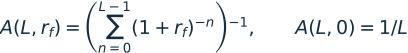

Source: `scripts/simple_industry_policy.py`; anchor: `def capital_service`; Representation: reindexed annuity-due identity, also explaining the capital-service convention.

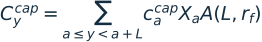

Source: `scripts/CAPEX_OPEX_Gurobi_settings_dual_industry_categories1.py`; anchor: `capital_finance_rate`; Representation: structural vintage-payment accounting; paid-back/existing-asset conventions remain asset-specific.

The reader's sparse-grid multiplier depends on the years in the applicable solve. It is not automatically equal to the distance between every pair of decisions.

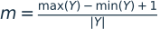

Source: `scripts/read_process_data.py`; anchor: `multip =`; Representation: reindexed solve-grid multiplier.

Variable costs include fuel, conversion operation, trade, carbon payments and configured shortages/surplus penalties. A representative-hour weight belongs in annual flow accounting exactly once. Restoring cost units requires following each implemented conversion and the overall objective multiplier.

Source: `scripts/CAPEX_OPEX_Gurobi_settings_dual_industry_categories1.py`; anchor: `_period_weight`; Representation: structural EUR-to-MEUR hourly-flow cost term, not the complete variable-OPEX equation.

## 3. Available capacity, retirement and investment windows

Available capacity consists of surviving legacy stock plus surviving new vintages. Each asset family has its own retirement curve, historical handoff and possible remaining-capacity fraction. A nominal lifetime should therefore not be replaced by an assumed abrupt retirement unless that is the actual branch.

Source: `scripts/Build_model_dual_industry_categories_named_debug.py`; anchor: `available_capacity_year`; Representation: structural capacity/vintage accounting; sigma denotes the family's implemented survival rule.

An annual build ceiling and a total installed ceiling are different constraints. For decisions in 2025 and 2030, the standard global investment windows are 2025 and 2026–2030 respectively. Resuming in 2030 must not redefine that global interval.

Source: `scripts/investment_windows.py`; anchor: `def investment_windows`; Representation: structural annual-limit aggregation and installed-capacity bound.

This summation is not universal for every legacy limit row: use the relevant family reader. In the supported annual industry-limit convention, a year-specific entry takes precedence over a scalar fallback; missing/blank fallback may mean unrestricted, while zero is binding. Generic and fuel-store readers have their own defaults. Never replace all missing investment limits with zero or a large arbitrary number without checking the selected sheet.

## 4. Electricity production and zonal balance

Dispatchable generation is bounded by available plant capacity. Reserve margins, ramp limits, CHP regions and fuel supply can impose further bounds.

Source: `scripts/Build_model_dual_industry_categories_named_debug.py`; anchor: `max_output_dispatch =`; Representation: reindexed dispatchable output bound.

The inspected non-dispatchable branch uses an equality to available output. It does not implement the same equation as a generic plant-level inequality with a freely chosen curtailment variable. System surplus/CEEP is handled elsewhere.

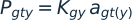

Source: `scripts/Build_model_dual_industry_categories_named_debug.py`; anchor: `max_output_nondisp =`; Representation: reindexed non-dispatchable generation equality; the year index on a depends on simple_curves.

The zonal electricity balance equates supply plus unserved-load relaxation to consumption, exports and surplus. The compact equation groups many separate source terms; only enabled modules contribute. Product-industry baseline removals and DSM adjust the basic demand term rather than add electricity generation.

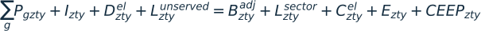

Source: `scripts/Build_model_dual_industry_categories_named_debug.py`; anchor: `name="el_balance"`; Representation: structural zonal balance with sector, carrier, conversion, storage and transfer terms grouped.

The source explicitly constrains changes in outside import/export flows. The compact ramp envelope below describes those flows, using the bound assembled from the applicable outside-route capacity and ramp coefficient. A GENCO column called RampUpRate does not by itself prove that every generator has an active hourly ramp constraint. Representative predecessor maps are not automatically continuous real-calendar chronology.

Source: `scripts/Build_model_dual_industry_categories_named_debug.py`; anchor: `max_transfer_systimpexp_outside_import_ramp_up`; Representation: structural outside-flow ramp envelope; initial-period and route-specific coefficients remain in the source.

Unserved-load and CEEP penalties have different physical meanings: the former relaxes shortage, the latter penalizes surplus. Turning off `ceep_limit` removes a cap, not necessarily the objective penalty. No equation in this model establishes nonlinear AC voltage stability, frequency response or N-1 security.

## 5. Electricity links, losses and outside trade

An active route is bounded by its available transfer capacity. HVDC is an eligible link technology with applicable converter requirements, not a separate energy balance. Primary, secondary and external routes use their own mappings and indices.

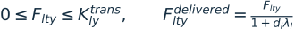

Source: `scripts/Build_model_dual_industry_categories_named_debug.py`; anchor: `name="el_balance"`; Representation: structural route-capacity bound with the delivered-flow loss convention appearing in the electricity balance.

Outside-system supply composition and normalized curves can add hourly import/export availability. Annual outside-trade calibration is an independent restriction; removing either one does not imply unlimited imports. Link duplications, different distance multipliers and secondary routes require reading the selected input rows rather than assuming one uniform distance/loss coefficient.

## 6. Stationary electricity storage and hydro

The examined stationary store withdraws `stat_discharge` directly from its inventory and applies `stat_grid_eff` to charging in the stock balance. Keep the electrical delivery convention in the separate electricity-balance terms; do not apply a second guessed round-trip efficiency.

Source: `scripts/Build_model_dual_industry_categories_named_debug.py`; anchor: `stat_storage_soc =`; Representation: reindexed stationary stock transition with its energy-capacity bound grouped.

The first period uses the configured initial stock rather than a nonexistent predecessor. Charging/discharging power limits and cyclic conditions are separate. One physical-hour stock transition must not be multiplied blindly by a representative annualization weight.

For the simple-curve reservoir branch, inflow is scaled by the source's plant reference capacity and hydro efficiency, while electrical generation withdraws stock divided by efficiency. Spillage is a stock outflow.

Source: `scripts/Build_model_dual_industry_categories_named_debug.py`; anchor: `name="storage_level_balance"`; Representation: reindexed reservoir balance; first-period initialization and year-indexed curves are separate branches.

Pumped storage also consumes electricity when pumping. Existing inflow, reservoir volume, turbine/pump power and annual calibration/caps constrain operation jointly. Pumped discharge is not a newly created primary renewable resource.

## 7. Native renewable-electricity share

Let `G_N`, `G_B` and `G_H` denote the raw modeled-period generation sums over the source's non-dispatchable, biomass and hydro collections. Let `G_F`, `G_P`, `G_D` and `G_R` denote its fossil, pumped-hydro, dam and run-of-river collections. The native RPS relationship is:

Source: `scripts/Build_model_dual_industry_categories_named_debug.py`; anchor: `rpscondition`; Representation: reindexed source-set summation; this row uses modeled-period sums rather than an assumed all-energy denominator.

These collection names describe actual source sets, not an assertion that every set is disjoint or that imports have certified renewable origin. The displayed source row does not explicitly apply representative-hour weights. Review the chosen temporal mode and set definitions before interpreting it as a weighted annual statistic. Setting rho to one does not impose 100% renewable energy in heat, transport, industrial materials or imported fuels.

## 8. Individual heat, district heat, CHP and thermal storage

Boilers and heat pumps convert their input to useful heat, but their coefficients have different physical interpretations. A COP above one represents ambient/source heat transferred into useful heat.

Source: `scripts/Build_model_dual_industry_categories_named_debug.py`; anchor: `heat_pump_ind`; Representation: structural boiler/heat-pump conversions, with fuel and COP mappings suppressed.

Individual and district balances combine enabled boilers, HPs, CHP, solar and thermal storage. District losses and the source's delivered-heat boundary must be retained.

Source: `scripts/Build_model_dual_industry_categories_named_debug.py`; anchor: `heat_balance`; Representation: structural heat-balance family; separate individual/DH and rolling-shortage branches are grouped.

The shared CHP helper attributes condensing-equivalent output to both fuel cost and combustion emissions:

Source: `scripts/energy_accounting.py`; anchor: `def power_fuel_input`; Representation: reindexed shared CHP fuel accounting.

CHP operating regions additionally couple electrical and thermal output. Supplying heat reduces the admissible electricity output in the extraction branch, while a separate power-to-heat relationship restricts feasible operation. The compact envelope below states that mechanism; exact coefficients and extraction/backpressure branches remain input-specific.

Source: `scripts/Build_model_dual_industry_categories_named_debug.py`; anchor: `gen_heat_extraction_max`; Representation: structural extraction-CHP upper envelope, not its complete feasible region.

Thermal stores shift heat between periods using charging/discharging efficiencies, losses, energy/power capacity and initialization/closure rules. Building HP storage, district storage and category industry storage are distinct asset families; enabling one does not activate the others.

## 9. Heating transition policies

Annual useful heat is obtained by aggregating the appropriate hourly service. A relative nonincrease or change limit applies to this scoped annual quantity, not necessarily to each hour.

Source: `scripts/fossil_heating_nonincrease.py`; anchor: `def add_fossil_heating_nonincrease`; Representation: structural annual heating/history accounting and nonincrease rule.

Fuel-specific boiler phaseout makes applicable boiler operation unavailable by its deadline. The source excludes CHP from this boiler-specific rule; other carbon and CHP heat restrictions may still bind. Electric/gas annual changes, CHP calibration and biomass nonincrease have their own scopes and tolerances. Turning one off does not turn the others off.

## 10. Legacy industry, categories and the pooled remainder

Useful industrial demand is allocated across eligible equipment, while final carrier input follows efficiency/COP. The category version adds the service/temperature category index to the same physical idea.

Source: `scripts/Build_model_dual_industry_categories_named_debug.py`; anchor: `industries_share_fuel`; Representation: structural industrial service/efficiency family; share variables and unit-specific carrier recipes are suppressed.

Detailed rows excluded from explicit modeling must be accounted for in the legacy pooled `simple_industry` worksheet. Excluding a row changes representation; it must not delete its demand. A valid mixed case can model selected services explicitly and pool the rest.

Source: `scripts/read_process_data.py`; anchor: `simple_industry`; Representation: structural accounting invariant for detailed-versus-pooled services; not a claim that every workbook formula is automatically recalculated.

An all-excluded case pools the applicable legacy industry. A fully detailed case can have an empty remainder. This pooled worksheet is unrelated to the separate product workbook `data/simple_industry.xlsx`.

Applicability ceilings cap a technology or fuel family's useful-service share. Shared substitution budgets prevent several alternatives from independently consuming the same replaceable service pool.

Source: `scripts/Build_model_dual_industry_categories_named_debug.py`; anchor: `industry_low_carbon_fuel_substitution_cap`; Representation: structural individual/shared service substitution limits.

## 11. Process-based complex industry

Only selected complex branches replace their overlapping legacy demand. Product activity and component intensities determine useful-service requirements and independent process emissions.

Source: `scripts/complex_industry_support.py`; anchor: `activity`; Representation: structural product/component service and process-carbon relationships; native activity may be tonnes or a declared index.

Non-energy feedstocks, combustion and process emissions must not be counted twice. Product demand, component coverage, compatible carriers and process capture are separate input dimensions. The author reports testing the complex formulation for non-metallic minerals; availability of additional process rows does not establish a validated transition in every sector.

## 12. Annual industry transition, HP applicability and heat storage

The annual direct-electric plus HP share is weighted by delivered industrial service. It is not the electrical input share because HP COPs differ from one and from direct-electric equipment.

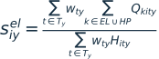

Source: `scripts/industry_annual_s_curve.py`; anchor: `def add_annual_industry_electricity_limits`; Representation: structural demand-weighted annual electric-service share.

The finite completion progress is a cubic smoothstep between the original base year and configured deadline. This is distinct from a generic logistic curve. Additional seed, growth, direction and reference-interval rules constrain the endogenous adoption envelope; the smoothstep below is not the complete S-curve implementation.

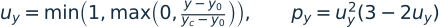

Source: `scripts/industry_annual_s_curve.py`; anchor: `def completion_progress`; Representation: reindexed finite completion-progress function.

A relative annual electric-share decrease allowance acts on the previous share. For a one-year step with a 10% reduction allowance, 40% becomes a minimum of 36%, not 30%. Multi-year history/reference-interval formulas must be taken from the helper.

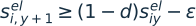

Source: `scripts/industry_annual_s_curve.py`; anchor: `industry_electric_share_max_annual_decrease`; Representation: structural one-year interpretation of the combined electric-service decrease bound.

Industrial HPs also share cumulative temperature and source-heat budgets. A 60°C potential and an 80°C cumulative potential are not independent quantities to add. Category thermal stores have separate energy inventory, charging/discharging and investment bounds and require category mode.

## 13. Transport service, stock and fuel compatibility

Fleet evolution combines surviving existing vehicles, surviving new purchases, retirement and eligible paid conversions. It is continuous vehicle-equivalent stock in this LP, not an integer fleet purchase schedule.

Source: `scripts/Build_model_dual_industry_categories_named_debug.py`; anchor: `name="veh_stock_balance"`; Representation: structural fleet/history/conversion accounting.

Service demand and final energy are separate. Stock, driving/activity profiles and primary/secondary fuel efficiency define the admissible hourly service and energy requirements. The notation below groups those technology-specific details in the coefficient `kappa`.

Source: `scripts/Build_model_dual_industry_categories_named_debug.py`; anchor: `name="transport_energy_profile"`; Representation: structural transport service/energy coupling; coefficients and native passenger-km/tonne-km conversions remain explicit in the reader.

Blend compatibility can be volume-based while the energy balance is energy-based. The model's conversion and paid-upgrade rules must be retained; a 10% ethanol volume limit must not simply be inserted as a 10% MWh share. Marine pilot fuel, upgrade costs and remaining life create additional requirements.

Annual service ceilings, stock electrification floors, turnover, investment limits and ICE fuel-composition ramps are distinct policies. V2G can discharge only within fleet battery/plug-in/driving constraints; the battery cannot both satisfy arbitrary mobility and arbitrary grid deliveries without its stock balance.

## 14. Hydrogen and e-fuel conversion

Hydrogen output is limited by installed conversion capacity. The appropriate input efficiency links electrolysis to electricity consumption and reforming to fuel/carbon inputs.

Source: `scripts/Build_model_dual_industry_categories_named_debug.py`; anchor: `name="h2_electrolysis"`; Representation: structural electrolyser capacity/input relationship.

E-fuel equipment has an output capacity bound. For each enabled conversion recipe, feedstock slots are proportional to output; coefficients have the slot's declared units, which can be MWh carrier, tCO2 or another physical feedstock unit per output unit.

Source: `scripts/Build_model_dual_industry_categories_named_debug.py`; anchor: `efuel_inputs1 =`; Representation: reindexed feedstock-slot proportionality with the separately implemented output-capacity bound grouped.

Each carrier must balance production, imports, storage and downstream uses. Hydrogen used to make another fuel is not also available to meet final H2 demand. Heat/electric auxiliaries and refinery process energy are additional coupled loads.

Source: `scripts/Build_model_dual_industry_categories_named_debug.py`; anchor: `efuelinput1`; Representation: structural carrier-node balance; transport, industry, refinery, terminal and transfer terms depend on the active carrier.

Carrier stores have asset-specific losses, efficiency, charging/discharging and annual boundaries. The generic expression indicates those roles rather than assert a universal efficiency placement:

Source: `scripts/Build_model_dual_industry_categories_named_debug.py`; anchor: `fuel_storage_capacity`; Representation: structural carrier-stock notation; inspect actual family coefficients, initial stock and chronological carryover rules.

The author's supplied integrated e-fuel setup enables both e-fuel modeling and explicit Oil/Gas product supply. Alternative supply exclusions need complete compatible data. Turning e-fuels on makes conversion available; demand, prices, resource limits and carbon constraints determine whether it is built.

## 15. Pipeline and terminal capacities

Without e-fuels, the standalone H2 pipeline and aggregate H2 terminal representations can be used where their dependency checks pass. With e-fuels, product transmission already includes the H2 pathway and the standalone H2-transmission flag is normalized off. Terminals can be used with or without e-fuels, but their input schemas and physical detail differ.

The standalone terminal throughput capacity is in TWh/year. Its total allowed loading/unloading throughput must be converted to MWh, while zonal H2 stores provide buffering. Shipping routes impose their own allowed directions, fleet, travel/delay and delivery assumptions.

Source: `scripts/h2_terminals.py`; anchor: `Terminal capacity is annual TWh`; Representation: structural aggregate shared-throughput limit; include the source's precise flow collection and scope.

Terminal activation and allowed directions are table-level choices in addition to `model_terminals=True`. An enabled terminal with no allowed/eligible route is not an unlimited import source. Aggregate delivered H2 terminals do not represent a detailed vessel/liquefaction/cracking chain unless that chain is supplied by the applicable product formulation.

## 16. CO2 feedstock, capture, amines and geological provenance

Industrial combustion factors used in the emissions budget and physically recoverable carbon used for capture/feedstock can differ for biogenic sources. For a combustion input, the compact relationship is:

Source: `scripts/complex_industry_accounting.py`; anchor: `def combustion_factor`; Representation: structural distinction between budget and physical capture/feedstock carbon.

Under the supplied convention, qualifying industrial biomass CO2 can supply feedstock while its biogenic combustion factor does not add fossil emissions to the aggregate budget. This is a bookkeeping convention, not proof of sustainable biomass or full lifecycle neutrality. Process emissions, captured process carbon, DAC and eligible biomass carbon can provide e-fuel CO2 under their actual mappings and capacities.

Source: `scripts/industrial_carbon_balances.py`; anchor: `def add_industrial_carbon_balances`; Representation: structural grouped CO2-bus accounting; source restrictions determine which terms may serve each destination.

Capture is bounded by both equipment and available flue gas. The separated process component is bounded by process emissions and the total capture; several capture technologies cannot each claim another copy of one branch's process stream.

Source: `scripts/industrial_carbon_balances.py`; anchor: `captured[key] <= rate * process`; Representation: reindexed process-capture upper bounds; shared-source bounds are additional.

An amine inventory separates absorber capture timing from stripper timing. The process-tagged inventory must remain a subset of the total physical amine inventory.

Source: `scripts/industrial_carbon_balances.py`; anchor: `inventory[key] == previous`; Representation: reindexed process-tagged amine stock relation.

With separated carbon balances, only eligible locally stripped process CO2 can supply geological injection. Untagged imports, reusable buffer withdrawals, DAC or combustion carbon do not gain process provenance by sharing a bus.

Source: `scripts/industrial_carbon_balances.py`; anchor: `Only locally`; Representation: structural provenance upper bound; the exact scoped process balance and competing uses remain in the source.

Geological inventory counts stored tonnes, while injection capacity counts tonnes/hour. Initial stock, total storage capacity and annual build limits are additional. Reusing CO2 in a fuel is not permanent geological sequestration.

## 17. Carbon limit, LULUCF and infeasibility

For the separated-carbon planning branch, non-process emissions plus net industrial process emissions must respect the policy allowance plus permitted removals. The source scales this row by 1000 numerically; the physical relation remains tonnes.

Source: `scripts/Build_model_dual_industry_categories_named_debug.py`; anchor: `CO2_total_non_process[year, System] + CO2_net_industry_process`; Representation: reindexed separated planning carbon cap before numerical row scaling.

Process emissions can make a stringent carbon cap infeasible even after fossil combustion is removed. Capture plus active geological stock/injection capacity can reduce eligible net process emissions, while a defensible LULUCF allowance can offset the budget. These are different mechanisms. LULUCF does not physically receive process CO2 and does not supply e-fuel feedstock.

Both the main storage/capture switches and matching active technology/capture/storage rows must permit geological handling. A True flag cannot overcome zero capacity/build limits, no capturable stream, missing reboiler energy or a forbidden source. The required-capture switch only concerns eligible capturable process carbon; uncapturable residuals can still violate a zero budget.

In rolling dispatch, a cumulative/weighted carbon allocation and optional penalized slack replace the ordinary planning cap treatment. A reported rolling solution with positive carbon slack has relaxed the strict allocation and must be disclosed as such.

## 18. Electricity demand-side management

Let `b` be basic electricity after its applicable decomposition and baseline removals. Signed DSM adjustments change timing but do not create generation. Daily and weekly classes share hourly power, including absolute activity, so opposite actions cannot hide capacity use.

Source: `scripts/electricity_dsm.py`; anchor: `dsm_total_absolute`; Representation: structural aggregation and absolute-adjustment linearization.

Source: `scripts/electricity_dsm.py`; anchor: `dsm_shared_power_capacity`; Representation: structural shared available-power and hourly baseline-fraction limits.

Each class balances energy within its block. The half-absolute sum counts moved MWh once rather than charge the upward and downward leg as two independent shifted quantities.

Source: `scripts/electricity_dsm.py`; anchor: `budget`; Representation: structural daily/weekly block closure and moved-energy allowance.

With both classes and energy budgets enabled, the weekly pool is a subset of daily-capable flexibility. At full rollout the supplied values give 5.5% daily-balanced plus 1.5% weekly-balanced, totalling 7%.

Source: `scripts/electricity_dsm.py`; anchor: `dsm_weekly_energy_fraction`; Representation: reindexed nested class-potential interpretation when both budgeted classes are active.

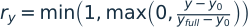

Source: `scripts/electricity_dsm.py`; anchor: `dsm_availability_full_year`; Representation: structural linear rollout for a full-availability year after the global base year; boundary validation remains in the helper.

Source: `scripts/electricity_dsm.py`; anchor: `def operating_cost`; Representation: structural DSM enabling/activation resource cost in EUR before the model's cost conversions.

The hourly 10% symmetric cap can limit moved energy to 5% of a block's load even if the energy allowance is 7%. An unexhausted energy allowance is therefore not by itself evidence that the modeled flexibility is uneconomic. Block balancing is not an appliance-specific delay/deadline model.

## 19. Product industry: recipes, stocks and mandatory demand

The separate product workbook supplies fixed plants/recipes and markets. Physical capacity is a production ceiling, not a requirement to operate at nameplate output. Electricity follows tonnes produced and the plant-specific MWh/t coefficient; non-electric inputs follow GJ/t recipes.

Source: `scripts/simple_industry_model.py`; anchor: `simple_industry_electricity_balance`; Representation: structural production-capacity/availability bound and reindexed electricity conversion.

Source: `scripts/simple_industry_inputs.py`; anchor: `def direct_factor`; Representation: reindexed fixed-recipe direct-carbon factor and structural fuel use.

Inventory preserves origin. A plant's output can be stored and then delivered to compatible destinations; delivery uses up inventory, and bounded initial/final stock rules prevent free product.

Source: `scripts/simple_industry_model.py`; anchor: `stock[key] == previous + output[key]`; Representation: reindexed plant material balance.

Mandatory markets must receive their prescribed annual tonnes under the applicable sample normalization and hourly demand/delivery limits. Optional markets impose sales ceilings rather than a compulsory sale.

Source: `scripts/simple_industry_model.py`; anchor: `mandatory`; Representation: structural annual mandatory/optional market interpretation; hourly profile constraints remain additional.

Outside suppliers share one annual budget across all destinations and have hourly caps. Optional route rows can restrict eligibility and route throughput/cost. There is no unlimited emergency product supply.

Source: `scripts/simple_industry_model.py`; anchor: `import_suppliers`; Representation: structural outside-supplier annual/hourly shared limits.

Calibrated baseline electricity removal avoids counting a real plant twice. Removals are year-specific MWh distributed by their profile; the example uses zero removals, so product plants add load.

Source: `scripts/simple_industry_model.py`; anchor: `def baseline_removed`; Representation: structural baseline-removal and added product-electricity accounting; excessive removals are rejected by the input logic.

Flexible eligible plants can vary hourly. With flexibility disabled, the corresponding operation is constant within each calendar day after availability adjustment; it can change between days. It is not equivalent to imposing a full-year flat production level or requiring local plants to satisfy all demand.

## 20. Industrial CBAM and domestic carbon pricing

For a modeled plant, direct emissions and entered precursor carbon determine the embedded footprint. Imported offers supply their own embedded factor. The domestic-price payment concerns direct emissions after its configured allowance; it is independent of the product border charge.

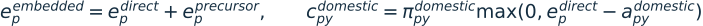

Source: `scripts/simple_industry_policy.py`; anchor: `def coefficients`; Representation: reindexed modeled-plant embedded factor and domestic per-tonne payment; imported suppliers use their entered footprint/cost treatment.

CBAM liability uses the supplied footprint, benchmark/free-allocation factor, EU price and eligible foreign credit. These max operations are performed on exogenous input coefficients before building the LP; they do not create a nonlinear variable-times-variable carbon-price calculation.

Source: `scripts/simple_industry_policy.py`; anchor: `liable = max`; Representation: reindexed exogenous liable-footprint coefficient.

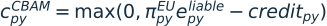

Source: `scripts/simple_industry_policy.py`; anchor: `cbam = max`; Representation: reindexed exogenous CBAM coefficient conditional on origin/start-year/exemption and destination eligibility.

The charge applies once to eligible delivery to an EU destination using original supply provenance. Fiscal/exporter/importer allocation can differ from territorial emissions. A cleaner modeled territory can simply be importing more embodied carbon; report both accounts. These equations describe the implemented scenario representation, not a legal compliance calculator or endogenous global steel-price equilibrium.

## 21. Electricity CBAM intensity and historical signals

Electricity Options 1–4 use their own membership, border and national-payment rows. At most one is permitted, and the inspected builder requires `Myopic=True`. They are independent of product CBAM and a quantity carbon cap.

An import-charge term is structurally transferred electricity times an exogenous source-zone intensity and applicable carbon price/credit. The precise border/national split depends on the selected option.

Source: `scripts/electricity_cbam.py`; anchor: `def intensity`; Representation: structural cost-coefficient interpretation; option-specific price and membership rows remain in the builder/cost script.

The intensity helper uses historical/base-year signals for the base year, realized predecessor signals for subsequent decision years, and permitted exogenous overrides/held signals in lookahead years. A valid zero intensity is retained. Missing or duplicate required realized history is an error, not a reason to assume zero-carbon imports.

## 22. Planning windows, representative accounting and rolling chronology

Ordinary myopic chunks are slices of the decision-year list. `chunk_size` and `step_size` count entries, whereas the partial-foresight lookahead is measured in calendar years.

Source: `main.py`; anchor: `def _build_myopic_chunks`; Representation: reindexed ordinary chunk construction with c=chunk_size and h=step_size.

Ordinary partial foresight instead selects future decision points up to the calendar lookahead. The decision year retains full hours; later years use their sampled blocks.

Source: `main.py`; anchor: `partial_foresight_lookahead_years`; Representation: reindexed finite-lookahead year selection; None uses the remaining tail.

The delivered representative capacity settings are four blocks of 24 hours, even though their identifiers contain the word week. A uniform 8760/96 factor is an accounting illustration for the supplied equal-weight sample; actual `_period_weight` and helper annualization must be followed in every family.

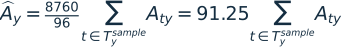

Source: `policy/runtime_policy.py`; anchor: `representative_week_hours`; Representation: derived equal-weight annualization example for four 24-hour blocks; not a universal storage transition multiplier.

In daily rolling mode, optimize 48 hours, commit 24, then advance by 24. In weekly rolling mode the corresponding values are 336, 168 and 168. The next solve receives the last committed state rather than the uncommitted end of the forecast window.

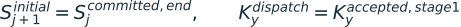

Source: `scripts/run_stage2_rolling_dispatch.py`; anchor: `rolling_realized_horizon`; Representation: structural rolling carryover and fixed-capacity principle; stock, route-delay, carbon and checkpoint metadata remain family-specific.

Guidance, terminal targets, reserve/shortage relaxations and forecast perturbations affect the rolling result. Full-year chronology with fixed capacity is different from reoptimizing capacity using full-year foresight. The author's report of improved no-e-fuel intra-annual stability is not evidence that every e-fuel/terminal/process combination has passed the same test.

## 23. Numerical scale, residuals and interpretation

Explicit row and column scales aim to improve conditioning without changing physical units. An equation divided by a large row scale can have a small solver residual while its restored physical residual is material.

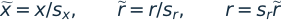

Source: `scripts/numeric_scaling.py`; anchor: `def balanced_row_divisor`; Representation: structural scaling identity; actual divisors vary by family.

Output completion is not a strict solution certificate when provisional acceptance, warning-only postoptimal checks or explicit slack are allowed. Report solver status, objective/gap where meaningful, physical MW/MWh/tonne residuals, nonzero shortages/carbon slack and which years were committed. The mathematical formulation, inherited assumptions and local solver outcome are distinct pieces of evidence.

## 24. How to use these equations in a study

Choose the physical representation first, then the time/information assumption, then the policy experiment. Record every departure from the delivered configuration. Associate each reported result with the relevant equation family, active input rows and physical unit. For example, new e-methanol output needs conversion capacity, H2, CO2, electricity/heat auxiliaries and compatible demand; a renewable-electricity share alone does not guarantee it appears.

Use [R02](REFERENCES.md#r02) for the published H2RES optimization background and the [reference register](REFERENCES.md) for data, technology and DSM sources. Cite the local version/hash and these later extensions separately. The source map is a reproducible documentation aid, not proof that all configurations or a complete national transition are feasible.
