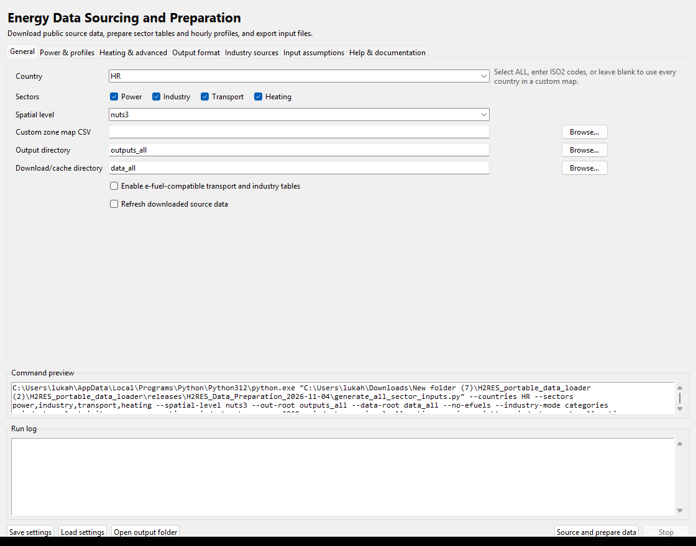
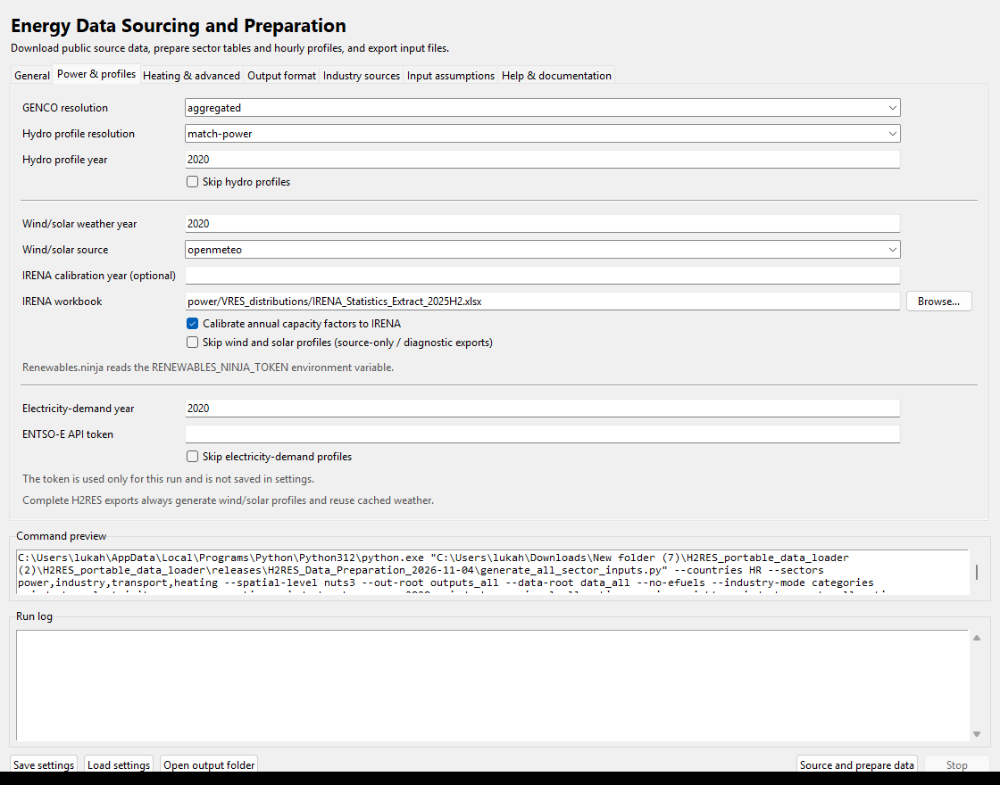
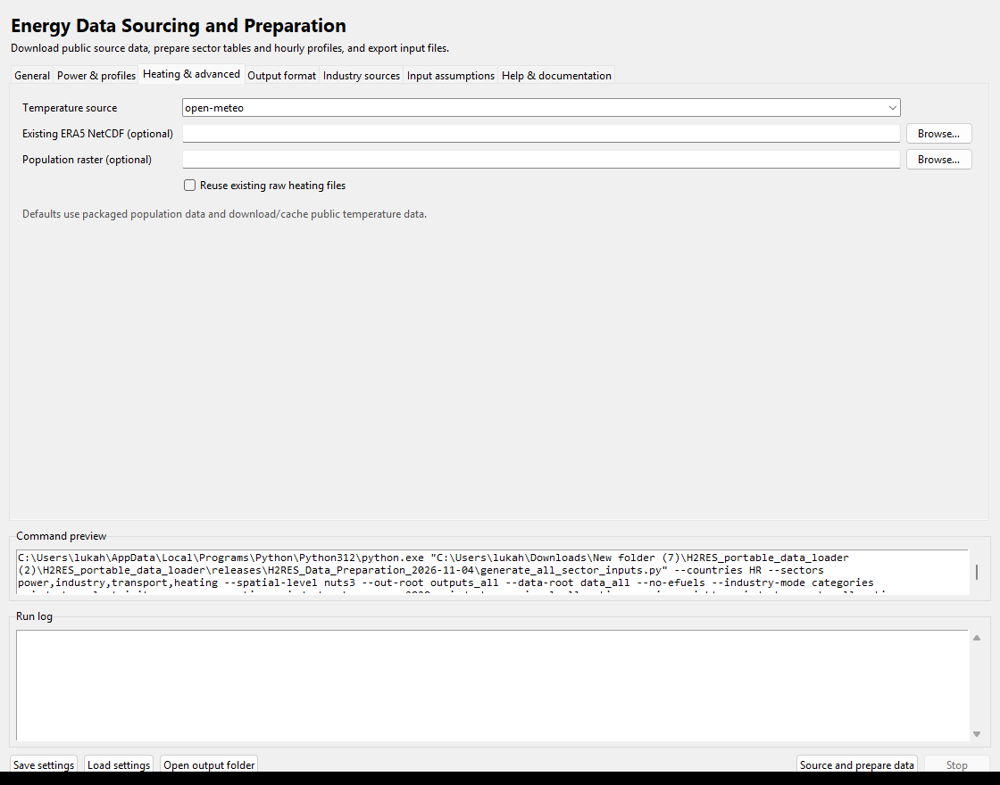
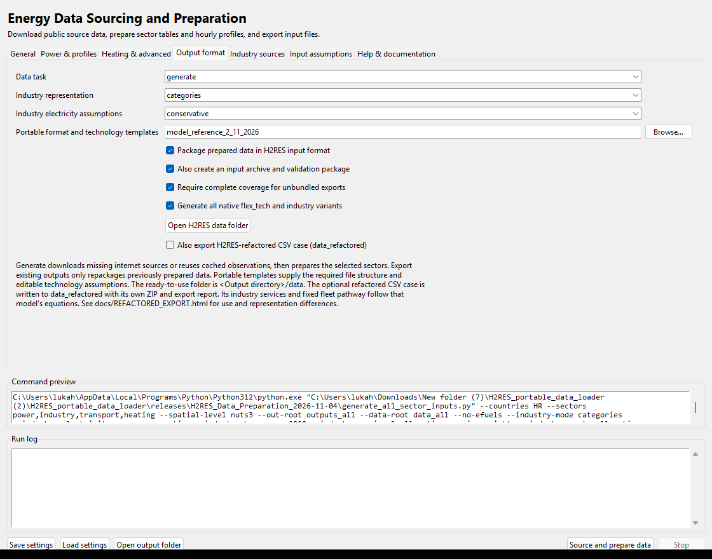
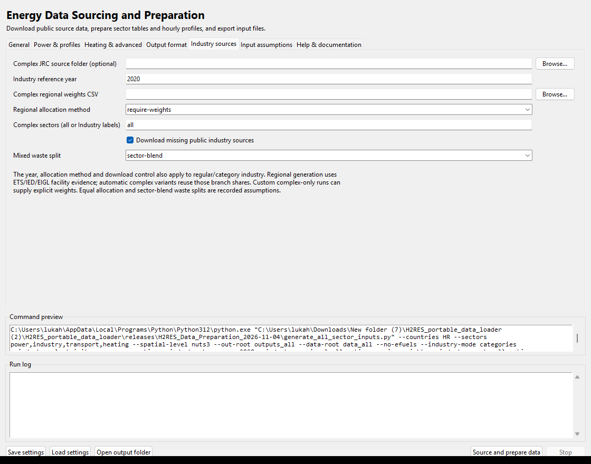
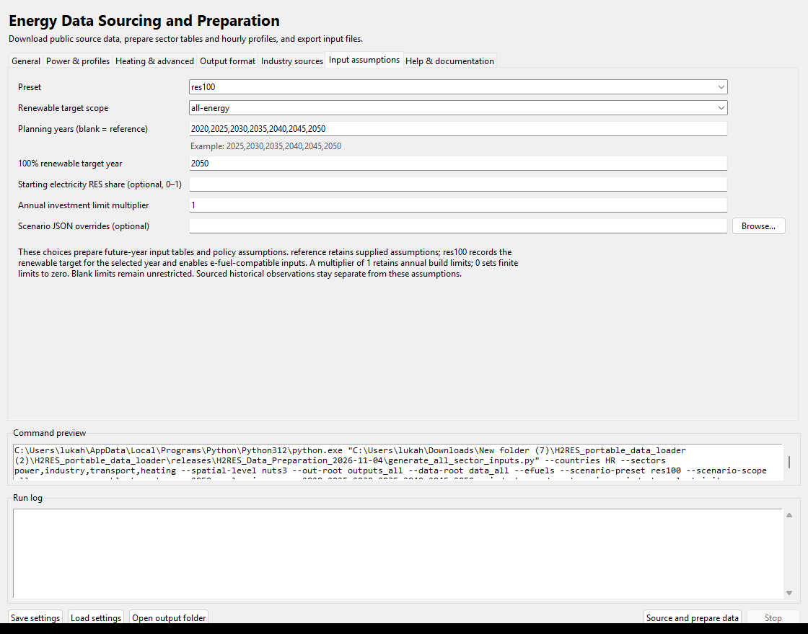
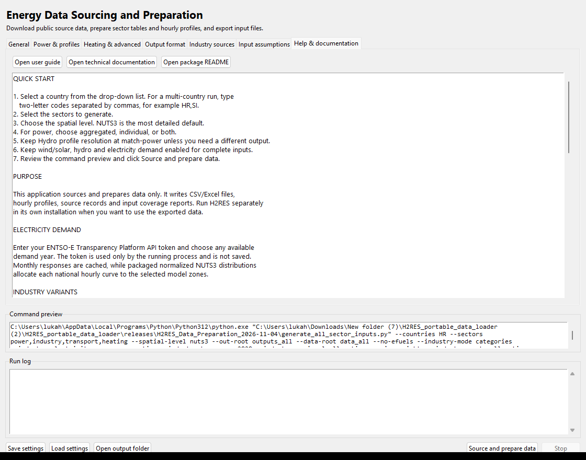

# H2RES Data Preparation: transfer and GUI guide

Release: **4 November 2026**. Windows 10/11, 64-bit Python. Python 3.12 is recommended for the tested offline setup; compatible Python 3.10+ can install dependencies online. Native input format: **H2RES_2.11.2026_novi**.

This package sources internet data and prepares H2RES inputs. The application window is named **Energy Data Sourcing and Preparation**. The energy-system optimizer belongs to a separate H2RES installation. The transfer folder includes the preparation source code, required local reference/source data, dependency wheels and documentation. Previously generated country outputs and completed input bundles are excluded. Run **generate** to produce the selected country's data.

**6 November update:** an optional CSV export also supports the bus-based H2RES-refactored model whose example is `data_chile`. Select it on **Output format** to create `data_refactored` and its ZIP. The [refactored export guide](REFACTORED_EXPORT.html) explains use, actual-reader checks, units, industry energy-service adaptation and prescribed transport fleet pathways.

## 1. Copy and set up on another machine

**GitHub download:** the attached `H2RES_Data_Preparation_*.zip` portable asset on **Releases** includes the complete hydro file and offline Python 3.12 wheels. The current **Code → Download ZIP** source also contains the required hydro data in `power/hydro/precomputed/runoff_shapes_2020.npz.parts`. Setup reconstructs the original 107,182,326-byte NPZ locally after verifying every part and the full SHA-256. No Git LFS or API token is needed for this reconstruction; source installations still download Python dependencies online. Keep the parts directory when copying the source package.

**Older source ZIPs:** a 134-byte `runoff_shapes_2020.npz` is a Git LFS pointer, not the actual hydro data. Copy the actual file from the working portable ZIP into that same location and rerun `SETUP_WINDOWS.bat`, or download the complete current source with its parts. Existing weather/source caches do not need to be deleted. Current setup also replaces an old pointer when the verified local parts are present.

1. Copy the complete `H2RES_Data_Preparation_2026-11-04` folder, or copy its ZIP and extract it completely. Open files from the extracted folder.
2. Choose a writable local folder, for example `C:\EnergyTools\H2RES_Data_Preparation_2026-11-04`. The code resolves its bundled data relative to this folder; a `D:\POSAO` installation is not required for data preparation.
3. Use an existing **64-bit Python 3.10+ / Anaconda installation with Tcl/Tk**, or install **64-bit Python 3.12** from the official Python website, including **Tcl/Tk and IDLE**, the Python launcher and pip. Python 3.12 is the tested offline option. Python is a prerequisite; this release does not contain an embedded interpreter.
4. Double-click **SETUP_WINDOWS.bat**. It searches standard Python, Anaconda/Miniconda, active Conda environments, registered interpreters and the Python launcher. Python 3.12 uses the bundled dependency lock and Windows wheels offline. Other compatible versions use `requirements.txt` and internet access to obtain matching wheels. All installations go into this folder's `.venv`; the base Anaconda environment is not modified. The setup log records each interpreter's version, architecture and Tcl/Tk result.
5. After setup succeeds, double-click **START_DATA_PREPARATION.bat**. The launcher uses the completed local `.venv` and verifies dependencies before opening the GUI. It reports an incomplete setup instead of switching to another global Python. `START_H2RES_GUI.bat` is a compatibility shortcut to this same application.
6. Optionally run **CHECK_PACKAGE.bat** to verify file hashes, the 43-file reference, local module imports and dependencies.

Use an ordinary account in a writable folder. After moving an already configured folder, rerun setup if its virtual environment no longer starts; virtual environments are created per machine and are not the portable component. The release itself contains no saved user configuration or API tokens.

Official Python downloads: https://www.python.org/downloads/windows/

If automatic detection does not select the intended interpreter, open PowerShell in the package folder and select it explicitly:

```powershell
.\SETUP_WINDOWS.bat -PythonExe "$env:USERPROFILE\anaconda3\python.exe"
```

`SETUP_WINDOWS.bat -CheckOnly` reports the selected interpreter and dependency mode without installing packages. Add `-Offline` only when using Python 3.12 with the included wheels. If Conda reports a Tcl/Tk or DLL problem, run setup from Anaconda Prompt so that environment is activated, or use standard Python 3.12 with Tcl/Tk.

## 2. General tab: country, geography and folders



Select a country such as `HR`, `IT` or `SI`; use `EL` for Greece. Multiple country codes can be separated by commas. `ALL` expands to the EU27 target list. Complete updated generation has been verified for Croatia; source coverage and required defaults can vary in other countries.

Choose `nuts3` for counties/small regions, `nuts2`, `nuts1`, `country`, or `custom`. A custom case requires your own mapping CSV with `country,nuts3,zone` columns. The same geography is applied across the sectors.

Open the [custom-zone guide and editable examples](CUSTOM_ZONES.html) for a complete HR/SI/IT map and the proposed Croatia/Slovenia/northern-Italy/offshore layout. Different aggregation levels can be combined across countries. Current complete-sector runs require all NUTS3 regions of every selected country; partial countries and independent zero-demand offshore zones are not supported yet. The clearly marked design files must not be used as runnable maps.

Keep **Power**, **Industry**, **Transport** and **Heating** enabled for a complete new-country export. Choose separate output and cache folders for different country/configuration cases. The default folders are `outputs_all` and `data_all` inside this extracted package.

Leave **Refresh downloaded source data** off to reuse downloads. Missing required public sources are still downloaded. Refresh requests updated sources and can change inventory vintages and cached results.

## 3. Power and profiles



**Aggregated** pools compatible generators within each selected zone. **Individual** preserves physical plants and their profile names. **Both** also writes supplementary individual outputs. Leave hydro resolution at **match-power** unless another representation is intended.

Choose the weather, hydro and electricity-demand years. Open-Meteo is the default weather service. IRENA calibration uses the bundled statistics extract; it is a calibration assumption, not another regional observation.

Enter your **ENTSO-E Transparency Platform API token** for national hourly load. It is passed to the generation process and excluded when settings are saved. Obtain credentials on the ENTSO-E platform using your own account. Renewables.ninja is optional and needs `RENEWABLES_NINJA_TOKEN` in the environment before launch.

### Open-Meteo HTTP 429 and resumable weather

HTTP 429 means the weather provider's request allowance was reached. Long historical queries count as multiple calls; 146 model units can require more than 146 site requests. The [provider's quota and call-accounting documentation](https://open-meteo.com/en/pricing) explains the public limits. Multiple preparation jobs or other clients on the same public IP can also consume that allowance.

Public wind/solar and heating downloads share a weighted request estimate **within each preparation run**. Every new run starts at zero. Country and sector subprocesses inherit the same run ID, while requests from earlier runs are excluded. Valid weather caches are read before any request or quota reservation, so successful downloads remain reusable.

Only minute/hour estimates proactively pace requests, with 10% headroom (540/minute and 4,500/hour). Day/month usage is informational and does not impose day-long or month-long local pauses. Full-year 2020 requests with up to 10 variables and one location/model count as approximately 26.14 estimated calls. The log reports this run's attempted requests and weighted calls. `.openmeteo_quota.sqlite3` stores run-scoped timestamps/counts and is excluded from shared packages. No deletion of old ledgers or weather caches is required. Starting a run resets the program's estimate; it does not change Open-Meteo's own counters or other clients' usage.

**HTTP 429 no longer ends acquisition.** Wind/solar and heating keep retrying the same request until it succeeds or you use Stop. A valid `Retry-After` (seconds or HTTP date) is honored in full. Without a server reset hint, retries wait 60, 120, 240, 480, then at most 900 seconds per retry. This also applies to daily/monthly rejections; the program periodically checks again rather than guessing a whole-day/month reset. Quota retries do not consume the ordinary network-error retry limit. Genuine permanent errors, such as invalid credentials or rejected parameters, still report failures. Completed caches and published curves remain protected.

`--openmeteo-max-wait SECONDS` remains accepted by the runner and standalone wind/solar script. It now caps an individual *local-estimate* pause before rechecking (default `0`: no cap); it never causes a quota timeout or shortens a provider-specified `Retry-After`. `--sleep-s` optionally adds a fixed post-download delay and defaults to zero. Keep the application running and the computer awake for automatic continuation. IRENA calibration occurs after weather acquisition and does not change weather request counts.

After a stopped weather run, retain the **same output and download/cache directories**, keep **Refresh downloaded source data** off, and choose **generate**, since missing weather still needs sourcing. For the reported Italy case these directories were `outputs_all_ITnuts3` and `data_all_itnutsHR3`. Resume after the quota resets. Completed, valid site weather is read from cache before any HTTP request. Cache writes are atomic; interrupted or incomplete responses are not accepted as complete annual weather. Existing published curves are retained on failure.

If you already have an authorized Open-Meteo Historical Weather customer key, set `OPEN_METEO_API_KEY` in the environment before launching the GUI. The downloader selects the official customer archive endpoint. Current Historical Weather access requires Professional or higher according to [Open-Meteo's plan documentation](https://open-meteo.com/en/pricing); check your account's access. The key is not saved in cache keys or GUI settings, and error messages redact it. For example, from PowerShell:

```powershell
$env:OPEN_METEO_API_KEY = "YOUR_HISTORICAL_WEATHER_KEY"
.\START_DATA_PREPARATION.bat
```

This optional customer-key handling applies to wind/solar acquisition; customer-endpoint requests bypass the public request ledger. Heating retains its separate public weather reader and cache but shares the public request ledger. Renewables.ninja remains an explicitly selected alternative with its own credentials and quotas; the generator does not silently switch providers.

Keep hydro, wind/solar and electricity-demand profiles enabled for complete model inputs. Skip controls are intended for partial source work; a successful generator inventory alone does not complete the electricity input set.

National hourly electricity is distributed using packaged NUTS3 shares from the JRC 2019 electricity map. Each hour sums back to the national total. Regions currently share the normalized national hourly shape, while magnitudes differ. The source map uses population and other spatial proxies; this is not a direct regional metering dataset or a population-only split.

## 4. Heating and advanced



Open-Meteo is the default temperature source. A local weather NetCDF and an alternative population raster can be selected explicitly. Standard regional generation uses eight reproducible inhabited grid samples per NUTS3 region, population-weighted temperatures, Hotmaps heat density, CHP locations and five EIGL fuel maps.

For the first run on a new machine, leave **Reuse existing raw heating files** off. With generation enabled, a raw calculation is independently reused when its method/source fingerprints and output hashes match. Previously generated centroid calculations are not accepted as the corrected method.

The bundled hydro runoff profiles cover the existing 2020 calculation and are local input data, rather than a live CDS download. Selecting a different hydro year requires a matching runoff package. An optional CDS weather workflow needs `SETUP_WINDOWS.bat -WithCds` plus your own CDS credentials and source-access configuration.

## 5. Output format



Set **Data task** to **generate** to download missing data and prepare the selected sectors. **Export existing outputs** repackages already prepared sector files; it does not repair their source allocation or make results from a different country/year current.

Keep complete export, strict input coverage, the input package and **Generate all native flex_tech and industry variants** enabled. The included `model_reference_2_11_2026` folder supplies the required schemas and default assumptions.

The final output is **<output folder>/data** with the model's 43 native filenames and directory layout. It includes `generators.csv`, all seven `flex_tech` paths, the four complex-industry companions, policy workbooks and hourly demand/availability/distribution files.

The chosen industry/e-fuel configuration determines the selected H2RES flags. Other generated variants remain available in the same data folder. Consult `model_input_selection.json` rather than choosing an arbitrary technology workbook.

## 6. Industry sources



Choose the industry calibration year and leave missing-source downloads enabled. Regular/category national observations come from JRC-IDEES-2021; the complex process compiler uses its JRC-IDEES-2023 source release at the selected calibration year.

Regional industry uses installation coordinates and sector-filtered ETS, IED and EIGL activity evidence. The initial ETS archive download is approximately 499 MB and is shared across countries. IED queries are country/year specific. Sector shares are used consistently in the automatically generated complex variants.

The exact source-priority rule and missing-sector assumptions are recorded. Missing branch coverage can use industrial-site-density defaults. For HR/2020 those branches represent about 11.37% of the legacy industrial input-energy margins. No population allocation is introduced as a hidden industry substitute.

For a custom complex-only allocation, provide explicit branch weights, or intentionally select an equal-allocation scenario. Equal allocation is an explicit assumption. It is not the default facility method.

## 7. Input assumptions and future years



The **reference** preset retains supplied scenario defaults. The **res100** preset records a renewable target, scope and target year. For whole-energy targets, the GUI enables the e-fuel-compatible representation. Enter planning years and investment changes when needed.

Historical observation years are separate from future planning years. Costs, efficiencies, lifetimes, technology options and investment limits include supplied assumptions. The preparation tool does not infer a policy target from historical data.

For a study using additional scenario runtime constraints, use the supplied scenario launcher with a separate H2RES installation. Preparing a renewable scenario does not demonstrate that an optimization is feasible.

## 8. Help, command preview and running



The **Help & documentation** tab opens this guide, the spatial-method audit and the package README. The **Command preview** shows the runner arguments for the displayed settings. Paths in screenshots are examples from the documentation build machine; the application resolves the copied package's paths on the target machine.

Click **Source and prepare data**. Follow the **Run log**. **Stop** requests termination of the running preparation process. A successful run returns the button to its normal state and reports the native output directory.

Allow source downloads and the large Excel exports to finish. Interrupted source requests can normally be resumed using the same cache. Keep workbooks closed when rebuilding the same output directory. A Windows staging-folder lock triggers a checked-copy publication retry; a failed export retains the previously published data and reports any preserved recovery bundle.

## 9. Understand the generated output

The transfer package starts without an output case. The `model_reference_2_11_2026/data` directory contains the schemas, reference tables and default assumptions required by the generator; it is retained as a local input. It is not a generated output for your newly selected country. Population, runoff, statistics and source snapshots are also retained where they are needed locally.

The default source configuration uses industry 2020, heating 2021, bundled transport activity tables for 2019, EIGL spatial maps for 2019, NUTS boundaries for 2021 and the selected weather/profile years. The source vintages differ. Prior Croatia validation checked all nine native input configurations. Those finished country datasets are not included in this release; their calculation method and assumptions are documented here.

Regular/category and complex industry use different national source releases and representations. Their numerical capacities can differ while using the same branch geography. Chemical feedstock is located in HR028 (Kutina's county); HR050 does not receive that feedstock allocation. A zero sourced generator or facility record is recorded explicitly and does not prove that all real local activity is absent.

After your own run, inspect these files outside the native data folder:

- `H2RES_DATA_manifest.json`: final selected configuration and validation.
- `model_inputs/validation.json`: native keys, sheets, calendars and coverage.
- `model_inputs/regional_input_quality.json`: verified regional allocation methods and source records.
- `model_inputs/h2res_inputs/model_input_selection.json`: workbook selection and H2RES flags.
- `model_inputs/h2res_inputs/H2RES_model_inputs.zip`: additional native input delivery.

Validation checks inputs and conservation; it does not run the optimizer. Use the generated `data` contents with a separate compatible H2RES installation. Study-specific network, policy and technology assumptions still need to match the intended scenario.

The export also checks `simple_industry` against the selected detailed source table. An empty simple table is correct when every industry service is modeled in detail. Generated plant names are linked to annual cost, maintenance and home-zone investment entries in every variant. Inspect `model_inputs/generator_input_links.json` for those mappings and defaults. Regional network connections missing from the reference are explicit virtual national-exchange assumptions, documented in `model_inputs/network_input_assumptions.json`; they do not describe a surveyed grid.

To load this exact folder without editing model paths, open a terminal in the output directory and run `python model_inputs/run_model_scenario.py --model-root "D:\POSAO\H2RES_2.11.2026_novi" --bundle .` using the separate model's Python environment. Add `--solve` to start its optimization. The launcher applies the exported variant selection and generated-name policy aliases. See the [native data guide](MODEL_DATA_2_11_2026.html) for variant overrides and assumptions.

For the supplied model version, use the generated launcher for regional runs: it also corrects the reader's legacy pooled-industry loop in memory so earlier regions' demand is retained. The original model files are preserved. Starting an uncorrected model directly after copying `data` does not apply this compatibility correction.

National annual policy totals remain national constraints. `model_inputs/policy_input_assumptions.json` records the scopes and any supplied generation target that lacks a matching sourced generator. Such unsupported calibration targets produce a warning and remain unapplied; the checked HR inventory has no biomass generator for the reference 0.6095 TWh biomass-power target. This does not certify the inventory as a complete census of all plants.

## 10. What is included and what downloads

Bundled inputs include the complete model-format reference, default technology/scenario tables, all-country NUTS3 electricity shares, the Eurostat population raster, the IRENA statistics extract, power source snapshots, the HR GENCO parameter template, Europe-wide 2020 plant runoff curves and the extracted complex-industry methods. The original handoff's three HR JRC source workbooks are retained as an offline source.

The process downloads missing GISCO boundaries, JRC country observations, ETS/IED/EIGL facility evidence, fuel/heat rasters, OSM country extracts, CHP/inventory updates when requested, weather point series and national ENTSO-E load. A raw national archive can contain unselected countries; calculations filter the requested selection.

The standard Python dependency wheels are bundled for Windows x64 / Python 3.12. Optional CDS packages can still download during their separate setup. API credentials and any custom geography/scenario/weight files are supplied by the user. Personal settings, API tokens, previous machine-specific caches and virtual environments are absent from the release. Cache folders can be large; allow space for downloaded rasters, archives and intermediate outputs. Regenerate source calculations after moving an old cache/output case so provenance reflects the new paths.

## 11. Troubleshooting

- **Missing annual investment trajectory for a Hydrogen_Storage generator:** update the program and retry **export existing outputs** with the same country, geography, variant selection and output folder. Hydrogen/heat/mechanical storage and batteries are not exported as electric generators. Records without finite nonnegative electric MW are also kept outside generator stock. These source records are retained in `model_inputs/power_asset_inventory.csv` with reasons and a JSON interpretation; a warning appears in `validation.json`. Storage MWh is not converted into assumed generator MW, and these inventory records are not automatically transferred into native storage stocks. Native storage defaults remain scenario assumptions. New source runs also save excluded raw records, including any original storage energy values, beside the GENCO intermediates. Financial linking and validation reject invalid generator capacity before allocating annual investment budgets. No weather or other source downloads are needed to retry this export-stage failure. The export is complete only after the data-folder publication and validation succeed.
- **Window does not open:** run `START_DATA_PREPARATION.bat -Check`, then inspect `DATA_PREPARATION_STARTUP.log` and `SETUP_WINDOWS.log`.
- **Python not found:** inspect `SETUP_WINDOWS.log` for the checked versions/architectures/Tcl/Tk results. Use `SETUP_WINDOWS.bat -PythonExe "C:\path\python.exe"` for an existing 64-bit Anaconda/Python 3.10+ installation, or install Python 3.12 with Tcl/Tk for offline setup.
- **Setup fails but a GUI previously opened in Anaconda:** close that window, run the updated setup, and restart through `START_DATA_PREPARATION.bat`. The corrected launcher uses the project `.venv` and verifies packages such as osmium, pyxlsb and pycountry before opening.
- **A geospatial package is missing:** rerun setup in this extracted folder. Installing into another Python does not update this folder's `.venv`.
- **An API rejects the request:** check your own credential, requested country/year, provider coverage and connectivity. Keep cached completed requests for the retry.
- **An old user path appears after copying:** start from the clean release settings, or correct the saved paths in the GUI. Do not copy `data_preparation_config.json` from another machine without reviewing it.
- **Regional method or hash check fails:** regenerate the affected sector using its cached downloads. Export existing cannot certify a stale calculation.
- **Final publication is blocked:** read `model_export_failure.json`. A completed `_unpublished_model_inputs_...` bundle can be published with `native_data_delivery.py`; the detailed method audit includes that command.
- **WinError 3 after all variants passed:** update the exporter and retain the reported recovery folder. The older nested ZIP staging path could reach Windows's legacy path limit. The [native data guide](MODEL_DATA_2_11_2026.html) gives the recovery command; a missing archive can now be rebuilt from the saved validated inputs without repeating source preparation.
- **Input files are complete but a study is infeasible:** inspect the separate model's scenario, network and technology assumptions. Input coverage does not solve the study.

## 12. Methods and references

Open the included **PAPER_METHOD_AUDIT.html** for the current spatial method, coverage assumptions and direct source links. **MODEL_DATA_2_11_2026.html** documents the native data layout. The existing H2RES complete manual, scientific references and BibTeX bibliography are also included; their original model/code inventories retain their stated snapshot date.

Primary source links:

- EU ETS installation compilation: https://zenodo.org/records/21414185
- EEA Industrial Emissions Portal: https://industry.eea.europa.eu/industrial-emissions/dataset
- JRC EIGL industrial sites: https://arcgis.jrc.ec.europa.eu/server/rest/services/eigl/EIGL_SERVICES_Industrial_infrastructure_PUB/MapServer
- JRC 2019 energy maps: https://data.jrc.ec.europa.eu/dataset/76a6b550-253c-44a4-9a4c-d22079e7bf62
- JRC-IDEES-2021: https://zenodo.org/records/15895830
- JRC-IDEES-2023 country distribution: https://jeodpp.jrc.ec.europa.eu/ftp/jrc-opendata/JRC-IDEES/JRC-IDEES-2023_v1/
- GISCO NUTS boundaries: https://gisco-services.ec.europa.eu/distribution/v2/nuts/
- Eurostat population grids: https://ec.europa.eu/eurostat/web/gisco/geodata/population-distribution/population-grids
- Hotmaps heat density: https://gitlab.com/hotmaps/buildings/heat/heat_tot_curr_density
- PowerPlantMatching: https://github.com/PyPSA/powerplantmatching
- JRC hydro database: https://github.com/energy-modelling-toolkit/hydro-power-database
- ENTSO-E Transparency Platform: https://transparency.entsoe.eu/
- Open-Meteo historical weather: https://open-meteo.com/en/docs/historical-weather-api
- Geofabrik OSM extracts: https://download.geofabrik.de/europe.html
- OpenStreetMap attribution: https://www.openstreetmap.org/copyright
