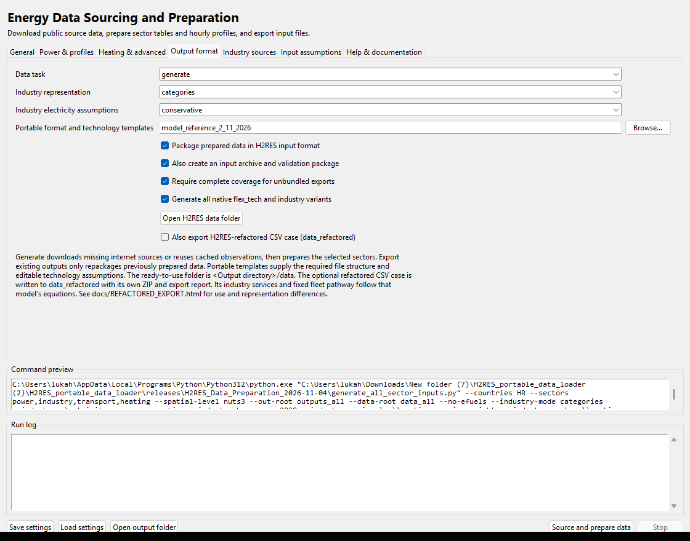

# Exporting inputs for H2RES-refactored

The optional export creates a CSV case for the bus-based refactored model whose example case is `data_chile`. The original workbook export remains available. No Chile demand, plant stock, fleet or illustrative cost values are copied. The portable `refactored_reference/contract.json` contains table headers and model-source fingerprints only.

## Using the preparation GUI

1. Select the countries, spatial resolution, sectors, industry representation, e-fuel option and planning years normally.
2. On **Output format**, keep **Package prepared data in H2RES input format** enabled and check **Also export H2RES-refactored CSV case (data_refactored)**.
3. Run **Source and prepare data**. For prepared sector outputs, select **export existing outputs** first; this does not repeat source downloads.
4. Open `<output directory>/data_refactored`. Its archive is `<output directory>/H2RES_refactored_inputs.zip` and contains the case under `data/`.
5. In the separate refactored model, select this case directory in place of `data_chile`. Enable the sectors listed in `export_report.json`, use the exported milestone years, periods 1–8760, and a one-hour time step.



The refactored case contains the selected configuration. The legacy `data` folder still contains the workbook variants. To change a refactored configuration without downloading observations again, export existing outputs with another industry/e-fuel selection. Keep the resulting case in a separate output directory if you want to retain both configurations.

## Command-line use

Add `--refactored-export` to the ordinary generation command. Existing preparation settings, including `--planning-years`, apply.

```powershell
python generate_all_sector_inputs.py --countries HR --out-root outputs_HR --data-root cache_HR --export-only --refactored-export
```

An already completed native bundle can be converted directly, without repackaging workbooks or accessing internet sources:

```powershell
python refactored_input_export.py --bundle outputs_HR/model_inputs --out-root outputs_HR --years 2025,2030,2035,2040,2045,2050
```

Specify `--industry-mode regular`, `categories` or `complex`, and `--efuels` / `--no-efuels` to select an existing generated variant. Complex selection exports the generated **category energy-service representation**, because this model has no corresponding process/product industry equations. Generate all native variants before converting a different variant.

`--refactored-model-root` on the main generator, or `--model-root` on the standalone converter, adds checks using that installation's actual reader and sector data preparation. This optional check needs that model's dependencies, including Pydantic and Gurobi's Python package; the ordinary CSV export does not. It does not solve an optimization or require modifying the model installation.

## Folder and references

The CSV names and subdirectories match the example model: root `buses.csv`, `fuel_cost.csv`, `transmission_lines.csv`, `policy.csv`, `learning_rates.csv`, `capital_cost_by_year.csv`; and sector directories `electricity`, `heating`, `efuel`, `transport`.

`heating/efficiency.csv` is an additional supported time-series input containing the generated hourly heat-pump COP. The included `load_prepared_case.py` passes it as `efficiency_ts_path`. A model runner that does not expose this path uses the annual-mean COP written in the converter table. Use the supplied loader helper for hourly COP:

```python
from load_prepared_case import load_case
system = load_case(case_directory, refactored_model_directory)
```

Check an exported case from the model's Python environment:

```powershell
python data_refactored/load_prepared_case.py --model-root C:/path/to/H2RES-refactored-main
```

This validates a 24-hour slice of **every exported year**, retaining all zones and assets. `--sample-hours 8760` requests the full year and can require substantial memory. `--reader-only` skips optimization-layer data preparation. The exporter's independent checks cover every hour in every year regardless of the sampled reader check.

Physical generator names stay unchanged, including their profile and annual investment-cost keys. Derived converter, storage, bus and fleet IDs are deterministic and include their region/service. `unit_mapping.csv` records source units. `FILES.json` records checksums; the ZIP is read back and verified before publication. A failed export retains the previous refactored folder and ZIP and writes `refactored_export_failure.json`. Native workbook export and refactored export have separate publication steps.

## Units and accounting

| Quantity | Export rule |
| --- | --- |
| Electricity and heat power | MW; hourly energy is MWh at a one-hour step |
| Generator/heat investment cost | Native MEUR/MW multiplied by 1,000,000 to EUR/MW |
| Storage investment cost | Native MEUR/MWh multiplied by 1,000,000 to EUR/MWh |
| Hydro reservoir stock | Native `STOCapacityGWh` multiplied by 1,000 to MWh |
| E-fuel storage stock | Native TWh multiplied by 1,000,000 to MWh |
| Electrolysis | Input-rated native MW and capex converted to output-rated target MW and EUR/MW |
| Industrial/boiler emissions | Native intensity per MWh of fuel divided by efficiency to obtain tCO2/MWh output |
| Transport activity | Annual million passenger-km/tonne-km multiplied by 1,000,000 and distributed by the normalized hourly activity curve |
| Transport efficiency | Native activity/kWh multiplied by 1,000 to activity/MWh |
| Vehicle batteries and chargers | kWh and kW divided by 1,000 to MWh and MW per vehicle |
| Fleet activity shares | Existing vehicle-count shares within each local mode, held constant over the horizon by default |

Grid observations include historical sector electricity. The refactored file contains **residual electricity demand** because heating, industry and mobility are represented explicitly. To prevent double counting while preserving the original regional distributions, the exporter subtracts sector electricity from each country's **annual total first**, then scales every original regional hourly grid curve by the same country factor:

```text
residual_fraction = (national_grid_MWh - national_sector_electricity_MWh) / national_grid_MWh
regional_residual[hour] = original_regional_grid[hour] * residual_fraction
```

This preserves the source's regional shares and each region's normalized hourly shape. Positive source demand remains positive whenever the national residual budget is positive. Genuine source zeros and a zero national residual budget remain zero. Regional annual quantities and country factors are recorded in `export_report.json`, including expected totals and zero-hour counts for each exported year. Declared zone/year policy multipliers are applied afterward; a deliberate zero multiplier can therefore also produce zero demand.

The distribution method is the **same as the older exporter**: the national ENTSO-E hourly curve is shared across regions and scaled by normalized JRC EIGL NUTS3 electricity-demand totals (or their prepared custom-zone aggregation). The refactored export reads that already-prepared result, preserving its curve and relative regional totals. It does not calculate a second regional weighting from the separately located industry and heating demands.

This replaces the earlier **regional hourly subtraction and clipping**, which erased demand in industry-heavy regions and distorted their distributions. The grid's regional allocation and separately sourced sector allocations are different estimates, often from different years. The corrected method is an explicit annual residual-demand allocation assumption; gross regional totals are not observations of household-only demand, and the combined coupled load need not reproduce the historical gross curve hour by hour. Annual sector electricity exceeding annual grid demand is an error. Copying gross electricity unchanged into the refactored residual file would double count the separately modeled sectors.

Native policy demand multipliers are then applied to residual electricity, individual heat, district heat and industrial service. Weather/activity profiles repeat across milestone years. This is a scenario assumption, not a forecast from downloaded data.

## Model differences to review

This is an adaptation to the refactored model's equations, not equivalent legacy optimization behavior. Read the case's `export_report.json` before running a study. `validation.json` also flags years when the prescribed baseline transport emissions alone exceed the inherited carbon cap. Such years need a different fleet pathway, policy or sufficient modeled carbon removal; input-format validation does not make that scenario feasible.

* Industry uses separate useful-service heat buses for selected branch/categories and a conserved remainder. NON_HEAT and feedstock alternatives are explicitly energy-service proxies; material balance, process production, stoichiometry and complex-industry capture constraints are unavailable. Feedstock proxies do not acquire combustion emissions.
* Transport follows an exogenous baseline fleet pathway. It does not optimize fleet purchases, fuel-switch retrofits or technology shares. Edit `transport/pathway.csv` and the fleet definitions to specify another pathway. Shipping with no observed vehicle count retains its conventional ICE service; vehicle stock is not invented. V2G is disabled by default.
* Annual build budgets, fuel-share limits, reserves, fixed OPEX, technology coupling and several legacy policy restrictions have no direct equivalent. Capacity ceilings and annual capital-cost paths are carried over. Investment costs remain assumptions inherited from the portable technology reference.
* Solar-thermal resource profiles are not bound by the target heat equations, so these options are listed as unmapped rather than given unconstrained production. Existing solar heat stock, if any, is recorded in the report.
* Internal electricity corridors are represented once per paired direction, respecting the native active-carrier flags. Where directional capacities or losses differ, the smaller capacity and lower delivery efficiency are used and recorded. Expansion is frozen where directional investment constraints cannot be carried over. Regional virtual links remain explicit reference assumptions. External electricity trade has no equivalent target input. Pumped hydro has no observed lower-basin volume in the source, so the target uses its open-loop lower-basin convention.
* E-fuel recipes, electrolysis, DAC and participating fuel stores are mapped to carrier buses. Synthesis is local to each region; legacy refinery, terminal, trade-portfolio and internal fuel-pipeline constraints are not recreated. Priced biomass supply uses the allocated native national ceiling, and target policy includes the annual biomass cap. Nitrogen storage inherits the native model's explicit `Gas_stor` price proxy when its own price is absent.
* Thermal buffers retain existing industry stocks and heat-pump tank ratios, with an explicit four-hour charging/discharging duration and no independent expansion. The original equipment/storage investment coupling cannot be reproduced. Non-e-fuel transport uses baseline fuel mixtures from a generated e-fuel counterpart when available; otherwise its Oil price and technology-row emissions are recorded as explicit proxies.
* Target policy has one system-wide cap/target per year. Selected country CO2 caps are summed, RES uses the strictest selected country target, and biomass TWh caps become MWh. Carbon-price scopes and sequestration/curtailment controls are left blank when no equivalent mapping is available. A blank cap means disabled; zero is a real zero cap.
* The legacy whole-energy `res100` preset is rejected for this export: an electricity renewable-share target and a prescribed baseline fleet are insufficient to enforce whole-energy renewable supply. Specify a suitable fleet pathway and policy in the refactored model.

## Contract sources

The implementation was audited against the supplied installation's `docs/INPUTS.md`, `docs/LIMITATIONS.md`, `data_loaders/load_system.py`, generator/storage/e-fuel/transport loaders, Pydantic schemas and `optimization_model/data_prep_*.py`, with headers from `data_chile`. `input_contract.json` identifies those exact source versions by SHA-256. This does not imply compatibility with a future reader whose contract changes.

Downloaded observations and their references remain documented in [the spatial method audit](PAPER_METHOD_AUDIT.html) and the native bundle's source records. [The native layout guide](MODEL_DATA_2_11_2026.html) describes the intermediate validated inputs used here. No online data fetch is needed to convert an existing bundle.
